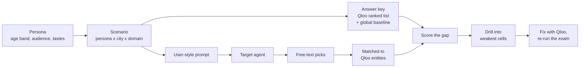

<div align="center">

# Blindspot

**Lighthouse for AI taste.**

Blindspot audits any AI agent for cultural blindness, using Qloo's taste graph as the answer key,
then patches it with Qloo so it recommends like a local.

[](https://github.com/nexuszephyr/Blindspot/actions/workflows/ci.yml)
[](LICENSE)


[Live demo](#live-demo) · [How it works](#how-it-works) · [Quick start](#quick-start) ·
[Architecture](docs/architecture.md) · [Roadmap](docs/roadmap.md)

</div>

---

## The problem

Ask an AI agent for "places to eat for a 25-year-old who loves street food in Bengaluru" and you'll
often get the same globally famous names it would give anyone, anywhere. It's guessing from the
average of the internet, and the average erases local taste.

Agents are getting good at reasoning and planning, but they are **culturally blind**. That shows up in
five ways:

| Failure | What it looks like |
|---|---|
| **Sameness** | Nearly the same answers in Lagos and Osaka |
| **Famous instead of local** | Globally popular picks, not what locals with that taste actually love |
| **Phantoms** | A café that doesn't exist, or closed years ago |
| **Shallow cross-domain guesses** | Music taste mapped to restaurants by vibe words alone |
| **Stale taste** | Last year's favorites |

You can't fix what you can't measure, and you can't measure taste without an answer key.

## What Blindspot does

Blindspot turns Qloo's taste graph into an exam for AI agents.

1. **Builds the exam.** Personas × cities × domains (dining, music, film/TV, brands) × probe types,
   phrased the way a real user would ask.
2. **Gets the answer key from Qloo.** For each question, Qloo returns what that audience in that place
   actually loves, plus a global baseline for comparison.
3. **Interrogates the target agent.** Any model behind an OpenAI-compatible endpoint.
4. **Scores the gap.** Taste-fit, famous-vs-local gap, swap sameness, phantom rate, combined into a
   Blindspot Score from 0 to 100.
5. **Hunts for weak spots.** An auditor agent drills into the worst cells and confirms each blindspot
   statistically before reporting it.
6. **Fixes it.** Gives the agent Qloo tools, re-runs the same exam plus a held-out set, and shows the
   honest before and after. The patch exports as a system prompt plus an MCP config.

## Why it only works with Qloo

Without Qloo there is no answer key, so Blindspot can't produce a single score. The demo makes this
visible: flip the **Qloo kill switch** and every score grays out.

| Qloo capability | How Blindspot uses it |
|---|---|
| Entity search | Resolve personas' tastes and agents' free-text answers to real Qloo entities |
| Tags | Turn cuisines, genres and interests into valid tag IDs |
| Insights with location filters | The local answer key: what this audience loves in this city |
| Insights without location | The global baseline that separates "famous" from "local" |
| Audiences | Persona targeting, especially for dining |
| Taste signals across domains | Bridge probes: music taste in, restaurant answers out |
| Trends bias | Freshness probes for dining |
| Candidate ranking | Scoring an agent's picks against an audience (under evaluation) |
| Cross-referenced IDs and coordinates | Evidence that a recommended place really exists |

## Live demo

**https://blindspot-tva4.onrender.com** ([health check](https://blindspot-tva4.onrender.com/healthz))

Right now the hosted service is the API foundation (`/healthz`, `/api/qloo/status`, `/api/qloo/search`),
serving live Qloo data within daily limits; the web UI lands in Phase 6. It runs on a free instance, so
the first load after a long idle period can take up to about a minute; after that it responds normally.
No key needed.

When the UI ships, the demo will open with **Roast an agent**: one click audits a preloaded model, and
precomputed results load instantly.

## How it works



**A worked example (illustrative).** Persona: a 25-year-old who loves street food, in Bengaluru.

| | Target agent alone | Qloo's answer key |
|---|---|---|
| What comes back | Global chains and the standard tourist list | Neighborhood spots locals with that taste favor |
| Same persona in Lagos | Almost the same list | A completely different list |
| Verdict | High sameness, high famousness, low taste-fit | — |

Our recon backs the premise: Qloo's top-10 lists overlap by at most about 12% between any two of six
test cities, so an agent that ignores place is easy to catch.

## Features

| Feature | Status |
|---|---|
| Judge-safe Qloo client: cache, budgets, rate limit, circuit breaker, deadlines, per-request kill switch | ✅ Built |
| Strict parameter guard (Qloo silently ignores unknown parameters) | ✅ Built |
| Three run modes: hosted, local with own key, local with no key | ✅ Built |
| Coverage matrix: 6 cities × 4 domains, all with rich Qloo data | ✅ Built |
| Scenario engine and Qloo answer key with validity checks | 🚧 Phase 2 |
| Coverage probe for any location ("try your own city") | 🚧 Phase 2 |
| Target adapters, entity resolver, metrics with calibration tests | 🗓 Phase 3 |
| Auditor agent with statistical confirmation | 🗓 Phase 4 |
| Qloo-grounded fix with before and after, exportable patch | 🗓 Phase 5 |
| Blind Map, Truth Table, Truth Receipts, kill switch UI | 🗓 Phase 6 |
| Model leaderboard: "Which AI knows Lagos best?" | 🗓 Phase 7 |

Progress and dates: [docs/roadmap.md](docs/roadmap.md).

## Quick start

Blindspot runs three ways. Judges don't need a Qloo key.

| Mode | You need | You get |
|---|---|---|
| **Hosted demo** | A browser | Real Qloo data, nothing to install |
| **Local, no key** | Python 3.11+ | Replay mode, fully offline: cached data only (see below) |
| **Local, own key** | Python 3.11+ and a Qloo hackathon key | Live Qloo data |

### Local, no key

```bash
git clone https://github.com/nexuszephyr/Blindspot.git
cd Blindspot
make setup
make demo
```

Then open `http://localhost:8000/healthz`. With no key the service runs in **replay mode**: it never
calls Qloo and serves only cached or snapshot data. A fresh clone has neither yet, so searches answer
`served_from: "degraded"` with a pointer to the hosted demo. The bundled synthetic snapshot
([ADR 0002](docs/adr/0002-no-real-qloo-data-in-git.md)) lands in Phase 2. Until then you can generate
one for offline development (synthetic data, clearly labelled, no Qloo data):

```bash
python scripts/export_snapshot.py --synthetic
QLOO_SNAPSHOT_PATH=data/snapshot/synthetic.json make demo
```

Port 8000 busy? `PORT=8010 make demo`.

### Local, with your own Qloo key

```bash
cp .env.example .env
# edit .env and set QLOO_API_KEY=<your hackathon key>
make demo
```

Hackathon keys only work against `https://hackathon.api.qloo.com`. Never commit `.env`.

### Without `make` (Windows)

```bash
python scripts/dev.py setup     # creates .venv and installs the locked dependencies
python scripts/dev.py demo      # same as `make demo`
```

By hand, the equivalent is:

```bash
python -m venv .venv
.venv\Scripts\activate          # macOS/Linux: source .venv/bin/activate
pip install -r requirements-dev.lock && pip install --no-deps -e .
python -m uvicorn blindspot.service.app:main_app --factory --port 8000
```

Exact commands for every platform, with expected timings, are in `docs/JUDGES.md`.

### Docker

```bash
docker compose up --build
```

## Configuration

Set in `.env` locally, or in the host's environment settings. The key never goes in the repo.
`.env.example` lists the common settings; [`src/blindspot/config.py`](src/blindspot/config.py) holds
every setting and its default. This table summarizes both.

| Variable | Default | Purpose |
|---|---|---|
| `QLOO_API_KEY` | empty | Your Qloo hackathon key. Empty means replay mode. |
| `QLOO_BASE_URL` | `https://hackathon.api.qloo.com` | The only base URL a hackathon key works with |
| `QLOO_MODE` | `live` | `live`, `record` (live + save raw responses) or `replay` (offline) |
| `QLOO_ENABLED` | `true` | Operations master switch |
| `QLOO_RPS` | `4` | Requests per second (Qloo's limit is 5) |
| `QLOO_MAX_LIVE_CALLS` | `600` | Lifetime live-call cap for this deployment's database |
| `QLOO_DAILY_LIVE_CAP` | `500` | Global daily live-call cap (hosted demo: `150`, [decisions D33](docs/decisions.md)) |
| `QLOO_CLIENT_HOURLY_CAP` | `60` | Per-visitor hourly cap |
| `QLOO_RUN_CAP` | `150` | Per-audit cap |
| `QLOO_DEMO_RESERVE` | `100` | Calls reserved for the demo, so floods can't starve it (hosted demo: `50`) |
| `QLOO_CACHE_PATH` | `data/qloo_cache.sqlite` | Cache and call log |
| `QLOO_CACHE_TTL_DAYS` | `7` | Cache lifetime (empty results expire after 1 hour) |
| `QLOO_SNAPSHOT_PATH` | `data/snapshot/snapshot.json` | Snapshot that seeds an empty cache at startup (Render: a Secret File). Not in `.env.example` |
| `REQUEST_DEADLINE_S` | `8` | Maximum time any web request may take |
| `IP_HASH_SALT` | empty | Salt for hashing visitor IPs (raw IPs are never stored) |
| `ALLOWED_ORIGINS` | empty | CORS allowlist |
| `TRUSTED_PROXY_HOPS` | `0` | Proxies whose `X-Forwarded-For` is trusted (Render: `3`: Cloudflare, Render edge, Render internal proxy). Not in `.env.example` |
| `HTTP_RATE_PER_MINUTE` | `30` | Per-IP request limit on `/api/*`. Not in `.env.example` |

Planned for Phase 2: `SNAPSHOT_URL` and `SNAPSHOT_TOKEN` for a private real-data snapshot
([ADR 0002](docs/adr/0002-no-real-qloo-data-in-git.md)). They don't exist yet.

## API

Every response that contains Qloo-derived data says where it came from. Today (Phase 1),
`/api/qloo/search` returns:

```json
{
  "served_from": "cache",
  "ok": true,
  "reason": null,
  "run_id": "run_…",
  "call_id": 12,
  "fetched_at": 1760500000.0,
  "results": []
}
```

The planned envelope (`data`, `synthetic`, `degraded_reason`; see
[architecture, Section 12](docs/architecture.md#12-service-api)) arrives with the Phase 2 routes.

`served_from` is one of `live`, `cache`, `snapshot`, `disabled` or `degraded`. Blindspot never passes
cached or sample data off as live.

| Route | Available | Purpose |
|---|---|---|
| `GET /healthz` | Now | Liveness |
| `GET /api/qloo/status` | Now | Mode, remaining budgets, cache, breaker state (no secrets) |
| `GET /api/qloo/search?q=` | Now | Guarded Qloo search |
| `GET /api/coverage?location=` | Now | Does Qloo have enough data for this place? |
| `GET /api/scenarios`, `/api/groundtruth/{id}` | Phase 2 | The exam and its answer key |
| `POST /api/audits`, `GET /api/audits/{id}` | Phase 4 | Run and read an audit |
| `POST /api/audits/{id}/fix` | Phase 5 | Run the Qloo-grounded fix |

There is no `/docs` page: the OpenAPI UI is switched off to keep the public surface small
([decisions D19](docs/decisions.md)). Full list:
[architecture, Section 12](docs/architecture.md#12-service-api).

## Project structure

```text
config/            cities, domains, demo queries (data, not code); personas, probe types in Phase 2
src/blindspot/
  qloo/            the only path to Qloo: client, params, cache, budgets, breaker, call log
  service/         FastAPI app
  scenarios/       exam generation                  (Phase 2)
  groundtruth/     Qloo answer key                  (Phase 2)
  targets/         target-model adapters            (Phase 3)
  resolve/         free text to Qloo entities       (Phase 3)
  metrics/         scoring                          (Phase 3)
  auditor/         the auditing agent               (Phase 4)
  fix/             Qloo-grounded re-run             (Phase 5)
web/               UI                               (Phase 6)
scripts/           recon, coverage, snapshots, secret scan
tests/             offline by default
docs/              architecture, ADRs, references, reports
```

## Development

```bash
make test                       # offline tests: no key, no network
make check                      # ruff check + ruff format --check + tests + secret scan
ruff check .                    # lint
python scripts/scan_secrets.py  # run before every commit
make docker-scan                # build the image and scan it for secrets
```

Live tests are opt-in: `QLOO_LIVE_TESTS=1 make test` with a key in `.env`. CI never calls Qloo.

CI runs on every push and pull request: a gitleaks scan of the full history, lint and tests on Ubuntu
and Windows, a fresh-clone demo with no key, and a Docker image scan. CodeQL runs once the repo is
public.

Contributing: [CONTRIBUTING.md](CONTRIBUTING.md). AI coding agents: [AGENTS.md](AGENTS.md).

## Documentation

| Doc | What's in it |
|---|---|
| [Architecture](docs/architecture.md) | Design, diagrams, metrics, data model, threat model, what each phase delivers |
| [Roadmap](docs/roadmap.md) | Phases, dates, status, cut order |
| [References](docs/references.md) | Sources, with what to use and what to avoid |
| [Decision records](docs/adr/) | Why metrics are rank-based, why no real Qloo data is committed, and more |
| [Glossary](docs/glossary.md) | Project terms |
| [JUDGES.md](docs/JUDGES.md) | How to run the demo, step by step, plus developer commands |
| [Qloo API reality](docs/qloo_api_reality.md) | What the Qloo API actually does, verified with recorded responses |
| [Coverage matrix](docs/coverage_matrix.md) | 6 cities × 4 domains × probe types, with the recommended set |
| [Phase 1 report](docs/phase1_report.md) and [audit](docs/phase1_audit.md) | Gates, live calls, findings and fixes |
| [Decisions](docs/decisions.md) | Small design decisions (ADRs cover the big ones) |

## Security and privacy

- The Qloo key exists only in server-side environment variables. It's masked in logs, errors, the
  cache and status output, and CI scans the tree, history and Docker image for leaks.
- No accounts, no personal data. Visitor IPs are stored only as salted hashes.
- Agent output and user input are treated as data: never executed, always escaped.
- Real Qloo responses are never committed; the public repo ships synthetic sample data.

Report vulnerabilities privately: [SECURITY.md](SECURITY.md).

## Limitations

- **Qloo is a strong proxy for taste, not absolute truth.** Blindspot measures gaps against Qloo's
  view of an audience.
- **Matching free text to entities is noisy**, especially across scripts, so every audit shows its
  match rate.
- **Coverage varies by place.** Cells with too little Qloo data are marked and not scored.
- **Hackathon keys expire after judging.** After that, local runs use the synthetic snapshot only.
- **Blindspot doesn't rank cultures or profile people.** Identity-based audiences are off by default.

## Built for the Qloo Agentic Hackathon

Blindspot is an entry in the [Qloo Agentic Hackathon](https://qloo.devpost.com/) on Devpost. The
challenge: agents can reason, plan and execute, but they're culturally blind, so give them real
cultural grounding with Qloo's API and taste graph. Blindspot answers it by measuring that blindness
and closing it, with Qloo as both the answer key and the fix.

## Acknowledgments

- [Qloo](https://www.qloo.com/) for the Taste AI API and the hackathon.
- Research on cultural bias in LLMs that shaped the framing; see [docs/references.md](docs/references.md#5-research-on-cultural-bias-and-llm-recommenders).

Blindspot is not affiliated with or endorsed by Qloo.

## License

[MIT](LICENSE) © 2026 nexuszephyr
