# Blindspot architecture

> **One line:** Blindspot audits any AI agent for cultural blindness using Qloo's taste graph as the
> answer key, then patches it with Qloo so it recommends like a local.

| | |
|---|---|
| Status | Phase 1 built and audited. Phases 2 to 7 are the design below; sections marked **Planned** aren't code yet. |
| Owner | @nexuszephyr |
| Last reviewed | 2026-10-16 |
| Related | [AGENTS.md](../AGENTS.md) · [roadmap.md](roadmap.md) · [references.md](references.md) · [glossary.md](glossary.md) · [ADRs](adr/) |

**Contents**

1. [Problem and approach](#1-problem-and-approach)
2. [Design principles](#2-design-principles)
3. [System context](#3-system-context)
4. [Containers and deployment](#4-containers-and-deployment)
5. [Repository and module map](#5-repository-and-module-map)
6. [Qloo client](#6-qloo-client)
7. [Scenario engine and answer key](#7-scenario-engine-and-answer-key)
8. [Targets and entity resolution](#8-targets-and-entity-resolution)
9. [Metrics](#9-metrics)
10. [Auditor agent](#10-auditor-agent)
11. [Fix loop](#11-fix-loop)
12. [Service API](#12-service-api)
13. [Web UI](#13-web-ui)
14. [Data model](#14-data-model)
15. [Run modes and data distribution](#15-run-modes-and-data-distribution)
16. [Security and threat model](#16-security-and-threat-model)
17. [Observability](#17-observability)
18. [Testing strategy](#18-testing-strategy)
19. [Phase plan: what each phase must achieve](#19-phase-plan-what-each-phase-must-achieve)
20. [Known limits, non-goals and open questions](#20-known-limits-non-goals-and-open-questions)

---

## 1. Problem and approach

**The problem.** Ask an LLM agent for "places to eat for a 25-year-old who loves street food in
Bengaluru" and it tends to return the same globally famous names it would give anyone, anywhere. It is
guessing from the average of the internet. That average erases local taste. We call this **cultural
blindness**, and it shows up five ways:

| Failure | What it looks like | Blindspot measure |
|---|---|---|
| Sameness | Nearly the same list in Lagos and Osaka | Swap sameness |
| Famous instead of local | Globally popular picks, not what locals with that taste love | Famous-vs-local gap |
| Phantoms | A café that doesn't exist or closed years ago | Phantom rate |
| Shallow cross-domain guesses | Music taste mapped to restaurants by vibe words only | Bridge taste-fit |
| Stale taste | Last year's favorites | Freshness taste-fit (dining only) |

**The approach.** Qloo's Taste AI knows, from anonymized behavior, what a given audience in a given
place actually likes, across domains. Blindspot turns that into an exam:

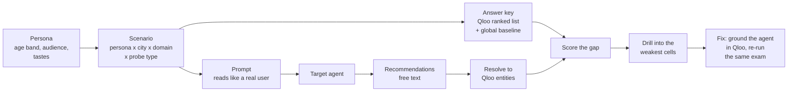

**Why it only works with Qloo.** Remove Qloo and there is no answer key, so no score can be computed.
The UI's kill switch demonstrates this live: flip it and every score card grays out.

---

## 2. Design principles

1. **Qloo is the answer key, never an LLM.** Ground truth comes only from Qloo. LLMs are allowed for
   target agents, explanation text and prompt phrasing, never for scoring.
2. **Judges can run it three ways.** Hosted, local with own key, local with no key. Nothing may break
   any mode ([ADR 0004](adr/0004-three-run-modes.md)).
3. **Truthful provenance.** Every Qloo-derived value carries `served_from`. Synthetic data says so.
4. **Evidence over assumption.** Every API behavior we rely on is VERIFIED with a recorded response.
   Parameters are allowlisted per entity type ([ADR 0005](adr/0005-strict-parameter-guard.md)).
5. **Rank first.** Metrics use overlap and rank; affinity only within one query
   ([ADR 0001](adr/0001-rank-based-metrics.md)).
6. **Honest scores.** No score on thin cells. Show the match rate. Report the real before/after delta.
7. **Quota is shared and finite.** 10,000 calls/month at 5 rps. Cache everything, precompute the demo,
   degrade instead of failing.
8. **Config is data.** Cities, domains, personas and probe types live in `config/`.
9. **Untrusted text is data.** Target output and user input are never executed and always escaped.
10. **Deterministic where it counts.** Scenario generation and scoring are reproducible from config,
    the lockfile and cached ground truth.

---

## 3. System context

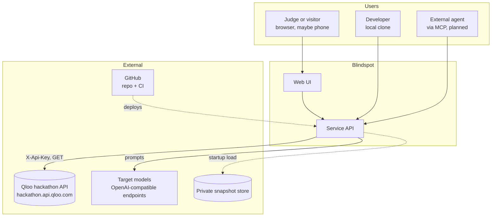

| Actor or system | Trust | Notes |
|---|---|---|
| Judge or visitor | Untrusted | No account. Rate-limited by salted IP hash. May click fast and in parallel. |
| Qloo API | Trusted data source | Silently ignores unknown parameters; may lack data for some places. |
| Target models | Untrusted output | Their text can contain anything, including instructions. |
| Private snapshot store | Trusted, secret | Holds real Qloo data for the hosted demo; never public. |

---

## 4. Containers and deployment

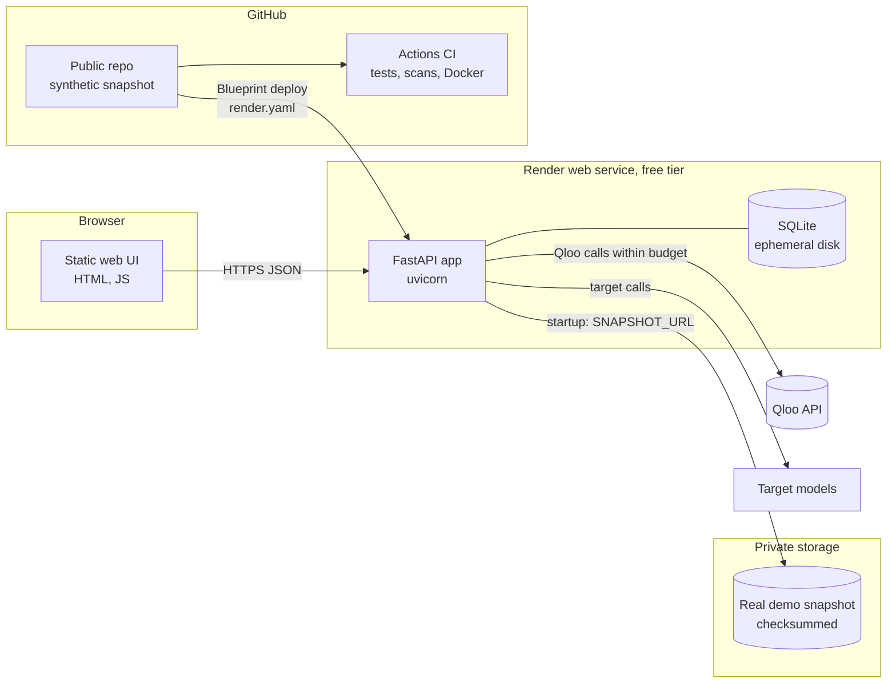

**Deployment facts that shape the design**

| Fact | Consequence |
|---|---|
| Render free tier sleeps when idle | First request after idle is slow. Mitigate with a warm-up route and a "waking up" UI state. |
| Render free disk is ephemeral | The cache can vanish. The app seeds SQLite from the snapshot at startup and never rebuilds ground truth on boot unless `WARM_ON_BOOT=true` within a capped budget. |
| Qloo key deactivates after judging | Long-term the repo runs from the synthetic snapshot only. |
| Real Qloo data can't be committed (pending terms check) | Hosted demo loads it from private storage via `SNAPSHOT_URL` and `SNAPSHOT_TOKEN`. |

---

## 5. Repository and module map

Existing after Phase 1 unless marked **Planned**. Verify paths against the code; the code wins.

```text
blindspot/
├── AGENTS.md  CLAUDE.md  README.md  LICENSE  SECURITY.md  CONTRIBUTING.md
├── config/                    # data, never code
│   ├── cities.yaml            # id, display_name, location (Qloo string), country, script_note, tier
│   ├── domains.yaml           # + depth, membership_pool, query_shape, probes (E12 to E15)
│   ├── demo_queries.json      # query list for warm_cache.py / export_snapshot.py (no Qloo data)
│   ├── personas.yaml          # taste-only personas + audience_policy (docs/scenarios.md)
│   ├── probe_types.yaml       # core, swap, bridge, audience, freshness: allowed domains, caps
│   ├── targets.yaml           # target models (D49, D50): env variable names, never values
│   └── resolved_ids.lock.json # Planned (Phase 2): IDs + our query text only
├── src/blindspot/
│   ├── config.py              # settings from env
│   ├── catalog.py             # load_catalog(): validates config/ and every cross-reference
│   ├── qloo/                  # the only way to reach Qloo
│   │   ├── client.py  models.py  params.py  errors.py
│   │   ├── cache.py   db.py      calllog.py budget.py  breaker.py  ratelimit.py
│   │   ├── context.py redact.py  snapshot.py cli.py
│   ├── service/               # app.py (main_app factory), routes.py, security.py
│   ├── web/                   # the web UI (#47): static/ HTML, CSS, JS, labels.json, mock/
│   ├── scenarios/             # Planned (Phase 2)
│   ├── groundtruth/           # Planned (Phase 2)
│   ├── targets/               # target models (#27): protocol, OpenAI-compatible client, parse, cache, CLI;
│   │                          #   calibration targets and the id lookup (registry) (#30)
│   ├── resolve/               # entity resolver (#29): resolver, match, report
│   ├── metrics/               # Planned (Phase 3)
│   ├── auditor/               # Planned (Phase 4)
│   └── fix/                   # Qloo tools and the tool loop for the grounded agent (#42); wrapper #43
├── scripts/                   # dev (task runner), _common, smoke, recon, coverage_matrix, warm_cache,
│                              # export_snapshot, scan_secrets, promote_param
├── tests/                     # offline by default; fixtures tiny and synthetic or trimmed
├── data/                      # gitignored: cache, raw recordings, private snapshot
├── docs/                      # this file, ADRs, JUDGES.md, qloo_api_reality.md, coverage_matrix.md,
│                              # phase1_report.md, phase1_audit.md, decisions.md, NEEDS_FROM_USER.md
├── Dockerfile  docker-compose.yml  Makefile  render.yaml
└── .github/                   # CI, CodeQL, templates, Dependabot
```

**Dependency rule.** Arrows point the only allowed way. Nothing imports the service layer, and only
`qloo/` talks to Qloo.

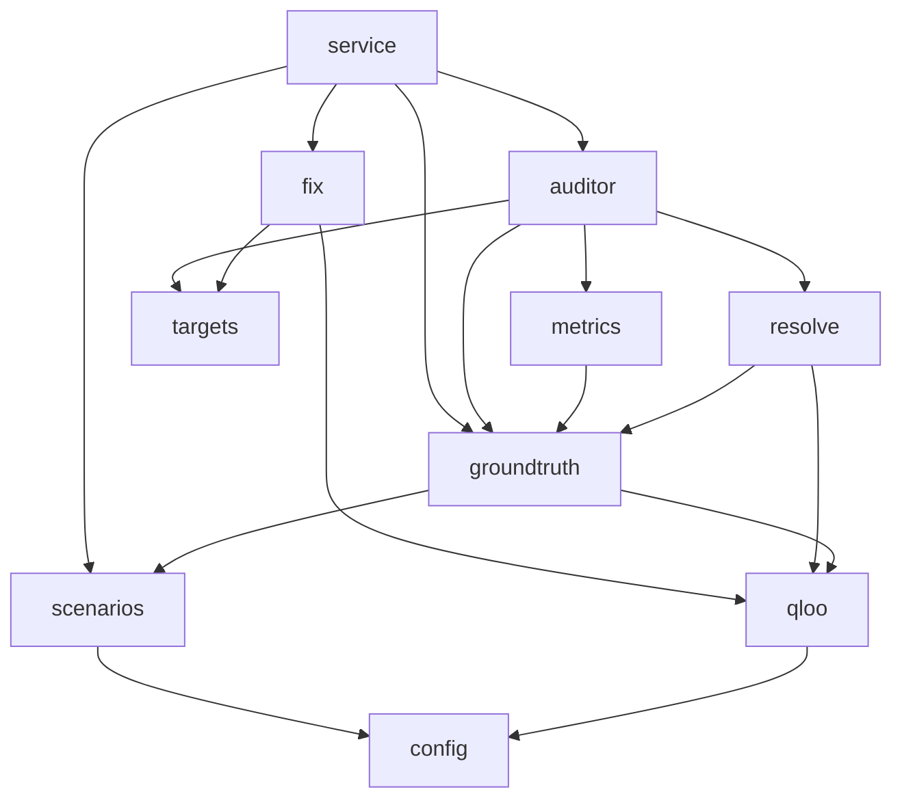

---

## 6. Qloo client

Phase 1, built and audited. All Qloo access goes through it.

### 6.1 Responsibilities

| Concern | Behavior |
|---|---|
| Endpoints | `/search`, `/entities`, `/v2/tags`, `/v2/insights` (GET, query string), audiences. Never `/recommendations` or `/recs`. |
| Auth | `X-Api-Key` header from server env only. Masked everywhere. |
| Parameters | Per-`filter.type` allowlist; strict mode raises `QlooParamError` before any call. |
| Name resolution | Entity, tag and audience names resolved to IDs first; free text never sent as an ID. |
| Outcome types | `ok`, `empty` (200, no entities), `resolution_failed` (no ID, no insights call), `qloo_error`, `invalid` (refused locally), `disabled`, `not_live` (replay, budget, breaker, deadline). |
| Cache | SQLite, key = sha256(method, path, sorted normalized params); TTL; bypass flag. |
| Budgets | Global daily, per-client hourly, per-run, plus a reserved demo slice. |
| Rate limit | Token bucket at `QLOO_RPS` (4, below Qloo's 5 rps limit). |
| Retries | Exponential backoff with jitter on 429, 5xx, timeouts; honors `Retry-After`; max 4 attempts. |
| Circuit breaker | Shared across callers; opens on repeated 429s, answers `degraded` instantly, auto-recovers. |
| Deadline | Per web request (default 8 s) covering resolution, retries and backoff. |
| Kill switch | Per request (`qloo_enabled=false` affects only that request); `QLOO_ENABLED` is the ops master switch. |
| Modes | `live`, `record` (live + save raw bodies), `replay` (cache and snapshot only, no key). |
| Call log | One row per call, queryable by `run_id`; powers Truth Receipts. |
| Errors understood | Both `{"error": ...}` and `{"errors": [...]}` shapes. |

### 6.2 Request path

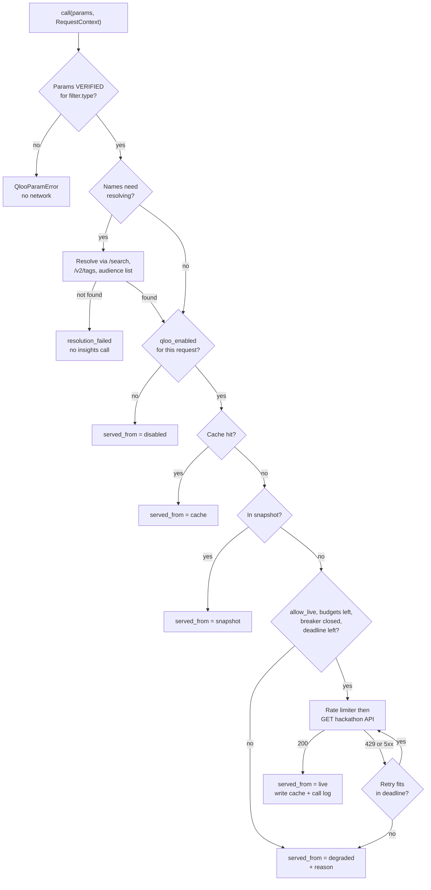

### 6.3 Circuit breaker states

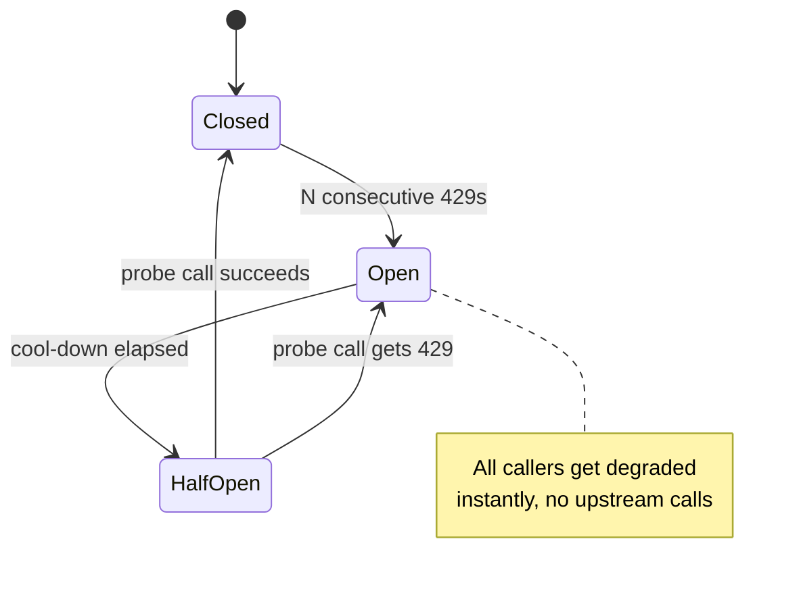

### 6.4 Budget scopes

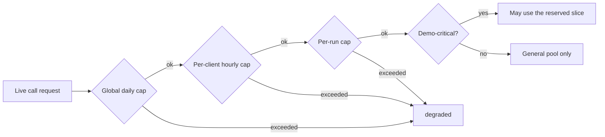

---

## 7. Scenario engine and answer key

**Planned, Phase 2.**

### 7.1 Concepts

| Concept | Definition |
|---|---|
| Persona | Taste-only descriptor, age band, a unique audience set (every domain's key uses it), interest tags and seed entities per domain; fields in [scenarios.md](scenarios.md) |
| City | From `config/cities.yaml`; the exact Qloo location string that worked in recon |
| Domain | `dining` (place), `music` (artist), `film_tv` (movie, tv_show), `brands` (brand); others possible |
| Probe type | `core`, `swap`, `bridge`, `audience`, `freshness` (see below) |
| Scenario | One exam question; content-hashed id `sc_…`; deterministic from config and the id lock. Fields and the build: [scenarios.md](scenarios.md#scenarios-the-generated-exam) |
| Answer key | Local ranked list + a baseline list from Qloo, 20 deep, plus a top-50 membership pool (E12). The baseline is global (same taste, no location) for music, film and brands, and the city with no persona signal for dining (D43) |

### 7.2 Probe types

| Probe | Setup | Detects | Evidence so far |
|---|---|---|---|
| `core` | Persona taste + location, ask a domain | Taste-fit, famous-vs-local, phantoms | Coverage rich in all 6 cities × 4 domains |
| `swap` | Same persona, two cities | Sameness | City overlap at most about 0.12, so the strongest probe |
| `bridge` | Taste stated in domain A, ask domain B | Shallow cross-domain guessing | To validate in Phase 2 |
| `audience` | Same place, different audience | Audience blindness | E15: viable for music, film and brands; marginal for dining (persona overlap 0.14 in the rich city, 0.75 in the focus city) |
| `freshness` | Trending-biased answer key | Stale taste | `bias.trends` changes dining only |

### 7.3 Answer-key build

```mermaid
sequenceDiagram
    participant CLI as groundtruth build
    participant SE as Scenario engine
    participant Lock as resolved_ids.lock
    participant QC as Qloo client
    participant DB as SQLite
    CLI->>SE: generate scenarios (seeded)
    SE->>Lock: read persona IDs, tags, audiences
    SE-->>CLI: scenarios with query specs
    loop each scenario not yet checkpointed
        CLI->>QC: local spec (location filter + taste signal)
        QC-->>CLI: ranked list, served_from
        CLI->>QC: baseline spec (global: shared per persona and domain; dining: per city)
        QC-->>CLI: ranked list, served_from
        CLI->>DB: ground_truth_items + entity_index + checkpoint
    end
    CLI->>CLI: below threshold? audit params, one broader retry
```

**Query shape rules** (from recon and E12 to E15): places always pair the location **filter** with a
taste signal (that's when scores exist, and the location signal timed out for restaurants); the dining
signal is the persona's **audience id** (E13: entity and tag signals were stable but took 5 to 28 s),
never age or gender; `bias.trends` only for dining. Every domain's answer key is 20 deep, with a top-50
membership pool. An agent's own picks are scored with `filter.results.entities` plus the persona
signal (E14); where that's only partial, rank membership in the top-50 pool is the fallback. The
per-domain table is in `docs/qloo_api_reality.md` ("Standard query shape per domain").

**Single read path:** `get_answer_key(scenario_id) -> AnswerKey` returns the local list, the baseline
list (global, or city for dining: `AnswerKey.baseline`, D43), an entity lookup, metadata and `served_from`. Later phases never query Qloo for ground truth
directly.

### 7.4 Validity suite

The answer key is only useful if it's stable and discriminating. Phase 2 must report:

| Check | Question | Fails when |
|---|---|---|
| V1 Determinism | Same query, same answer? | Top-10 set stability below about 90% |
| V2 Param effectiveness | Does each parameter change results? | Any parameter the design uses is INEFFECTIVE |
| V3 Discrimination | Do city and persona changes change the answer? | Median swap Jaccard above 0.7 for a domain |
| V4 Coverage | Enough results to score? | Cell below the recalibrated threshold |
| V5 Local vs famous | Does the local list differ from the baseline (global; city for dining, D43)? | Near-identical lists |
| V6 Score sanity | Scores present, monotonic, no duplicates, hub entities found | Broken ordering |
| V7 Existence readiness | Do places carry coordinates or external IDs? | Low coverage weakens the phantom metric |
| V8 Name round-trip | Does `/search` find an entity by its own name? | Sets the resolver's ceiling |
| V9 Plausibility | Do top results look right to a human? | Maintainer review flags problems |

---

## 8. Targets and entity resolution

Phase 3. Built: target adapters (#27, D50), calibration targets (#30, D51) and the resolver (#29, D47).

### 8.1 Target adapters

- Any OpenAI-compatible chat endpoint. Preloaded targets for the demo, configured server-side.
- A fixed system prompt asks for structured JSON: `{"recommendations": [{"name": "...", "why": "..."}]}`,
  with tolerant parsing and one repair retry.
- The user prompt is one of the scenario's neutral prompt variants. It never contains the answer key.
- Responses are cached by (target, model version, prompt hash) so demo runs cost nothing to replay.
- Bring-your-own endpoint is optional and off by default: it blocks private, loopback and link-local
  addresses to prevent server-side request forgery, and has its own strict limits.

Preloaded targets (decisions D49): GPT-OSS 120B (the fix-loop agent) and GPT-OSS 20B, optionally
Qwen3.8 27B (all on Groq), and Gemini 3.8 Flash (Google AI Studio; an audited target, precomputed only),
all on free tiers. Only GPT-OSS 20B is called live from the hosted demo, behind caps; the rest are
precomputed.

Built in #27 (D50): `targets.Target` is a protocol, `async recommend(prompt, k, *, scenario_id) ->
TargetResponse`, and a target never raises for a model or endpoint failure: the response has an
`outcome` (`ok | empty | malformed | refused | timeout | error`), up to `k` items (`name`, `why`),
`raw_text`, `model`, token `usage`, `latency_ms` and `served_from` (`live | cache`).
`OpenAICompatTarget` reads one entry of `config/targets.yaml` (env variable names only): Bearer auth,
temperature 0, `seed` and `extra_body` per target (D49's quirks), a per-target timeout and concurrency
limit, and bounded retries on 429 and 5xx that honour `Retry-After`. Answers are parsed tolerantly
(fences stripped, first JSON object, partial items of a truncated answer, one repair retry, list
lines) and replayable ones are stored in `target_responses_cache` (`data/targets.sqlite`), keyed by
target, model, prompt hash, temperature and `max_tokens`. `blindspot target ask --target <id>
--scenario <id>` prints the parsed names (local use only).

Built in #30 (D51): four calibration targets with known answers implement the same protocol and are
picked by id through `targets.open_target` (also `blindspot target ask --target calib:<name>`):
`calib:qloo-copy` (the local answer key's top `k`), `calib:global-top` (one fixed list per domain:
the entities most frequent across the domain's baseline lists, ties by id; for dining the city
baselines, D43), `calib:random-real` (seeded random index entities of the domain's types, outside the
scenario's pool) and `calib:invented` (seeded fake names, each checked against the index). They read
stored answer keys through the `groundtruth` read API only, make no network call, and answer
`served_from: cache` with zero usage; a scenario without a built key is `outcome: error`. Section 9's
calibration tests (#32) run the metrics on them.

### 8.2 Resolver

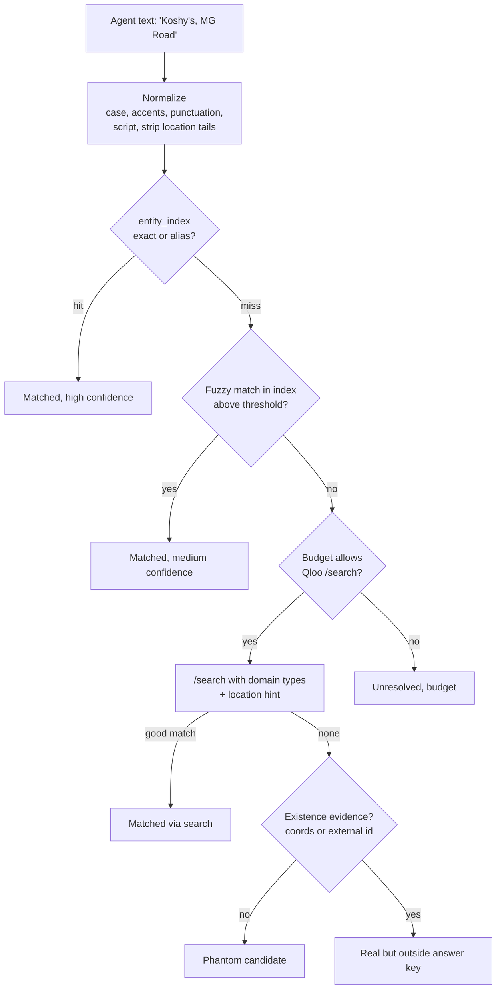

Outputs per recommendation: `qloo_id` or none, confidence, method, and status (`matched_in_key`,
`matched_outside_key`, `phantom_candidate`, `unresolved`). The match rate is always reported; V8 sets
its realistic ceiling.

Built in #29 (D47): `resolve.Resolver.resolve(texts, domain_id, city_id, key, ctx)` returns one
`Resolution` per pick with `qloo_id`, `name`, `rank`, `confidence`, `method`
(`index_exact | index_alias | index_fuzzy | search_exact | search_alias | search_fuzzy | none`), `status`,
an unresolved `reason` and `served_from`. `/search` sends only `query`, `types` (the domain's
`search_types`) and `take`; there is no verified location hint, so the city is used locally: for places,
a same-name entity far from the median of the answer-key pool's coordinates is not this city's.
Unbroken ties are `unresolved` (`ambiguous`). Search hits are added to `entity_index` through
`groundtruth.add_search_hits`, so a re-run resolves offline (not into a snapshot-built store, D47).
`resolve.match_rates()` reports the match rate per domain and script against the V8 ceiling (pending #21). Fuzzy thresholds are provisional until V8.

---

## 9. Metrics

**Planned, Phase 3.** Formulas are the starting proposal; Phase 2's `docs/metrics_design.md` may adjust
them with evidence. Notation: agent list `A` (resolved, top-k), local answer key `L`, baseline `G`
(global for music, film and brands; for dining, the city's list without the persona, D43), `rank_L(x)` the 1-based rank of `x` in `L`.

| Metric | Formula (proposal) | Range | Good |
|---|---|---|---|
| Overlap@k | `|A_k ∩ L_k| / k` | 0 to 1 | high |
| Rank-weighted taste-fit | nDCG-style: `Σ_{x∈A_k∩L} 1/log2(1+rank_L(x))`, divided by the ideal sum | 0 to 1 | high |
| Famousness | `|A_k ∩ G_k \ L_k| / |A_k|`: agent picks that are popular with everyone (anywhere; for dining, in this city) but not favorites of this taste | 0 to 1 | low |
| Local hit share | `|A_k ∩ (L_k \ G_k)| / |A_k|`: picks only a local would know | 0 to 1 | high |
| Swap sameness gap | `J(A_city1, A_city2) − J(L_city1, L_city2)`, J = Jaccard | −1 to 1 | ≤ 0 |
| Phantom rate | phantom candidates / all recommendations | 0 to 1 | low |
| Blindspot Score | `100 × weighted mean` of normalized components, per cell and overall | 0 to 100 | high |

**Rules**

- Hub entities that appear in many answer keys are down-weighted (inverse frequency), so naming one
  famous chain everywhere doesn't earn credit everywhere.
- Unresolved items are reported separately and never counted as phantoms.
- Cells marked thin or empty get no score; the UI shows "insufficient Qloo data".
- A cell is a **confirmed blindspot** when the upper bound of its bootstrap 90% confidence interval is
  below the threshold (Section 10).

**Calibration tests (must pass before any score is shown).** The four targets are built (#30, D51):
`calib:qloo-copy`, `calib:global-top`, `calib:random-real`, `calib:invented`.

| Synthetic target | Expected |
|---|---|
| Qloo copy (returns the answer key) | Score near 100 |
| Global top-10 for everyone | Low taste-fit, high famousness, high sameness |
| Random real entities | Near zero |
| Invented names | Phantom rate near 1 |

---

## 10. Auditor agent

**Planned, Phase 4.** The agentic part: it decides what to test next.

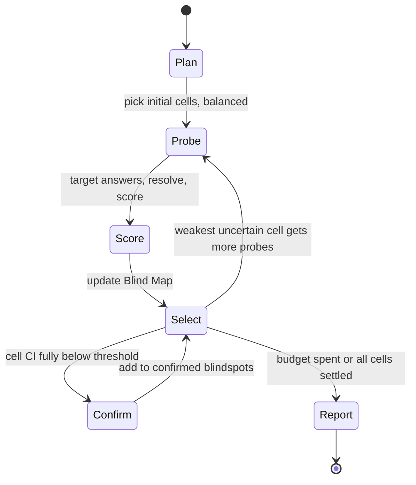

- **Selection:** explore/exploit over cells, for example an upper-confidence-bound rule that favors
  low, uncertain cells.
- **Confirmation:** bootstrap over scenarios and prompt variants within the cell; at least N probes.
- **Budgets:** Qloo calls, target tokens, wall time. Stops cleanly and reports partial results.
- **LLM use:** only to phrase follow-up prompt variants and write the plain-language explanation.
  Scores stay deterministic.
- **Trace:** every step emits an event (`plan`, `probe`, `score`, `select`, `confirm`, `report`) that
  the UI streams.

---

## 11. Fix loop

Phase 5. Built: the Qloo tools and the tool loop (#42, D52). Planned: the grounded wrapper and the
same-exam re-run with the held-out set (#43), and the export (#44).

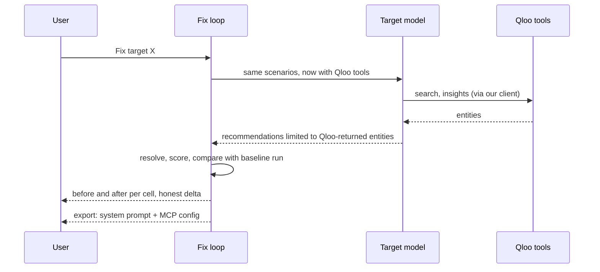

- The grounded target gets Qloo tools that call our client (so budgets, cache and receipts apply).
- Grounding rule: it may only recommend entities Qloo returned in this conversation.
- The comparison uses the **same** scenarios and prompt variants as the baseline audit.
- A held-out set of scenarios guards against the fix just memorizing the answer key: report both.
- Export: a system prompt plus an MCP server config that others can install. A full MCP server is a
  stretch goal.

**Tools (built in #42, D52).** Exactly two JSON-schema functions, run by `fix.QlooTools` through
`QlooClient` with the audit's `RequestContext`:

| Tool | Arguments (validated, `extra=forbid`) | Qloo calls | Returns to the model |
|---|---|---|---|
| `qloo_search` | `query` (1 to 100 chars), `type` (the domain's `search_types`) | `/search`, `take` 10 | name, type, id |
| `qloo_recommend` | `domain`, `city` (catalog ids), `interests` (1 to 5, up to 80 chars each) | per interest `/v2/tags` (tag of the domain's families) else `/search` (exact name); then `/v2/insights`: the domain's standard shape + `signal.interests.tags`/`.entities`, `take` 20 | rank, name, type, id; unresolved interests with a reason |

- **Honesty rule.** The answer key is audience + location. The tools never take an audience,
  demographic or raw Qloo param from the model, never send `signal.demographics.*`, and refuse a
  query whose shape (without `take` and the own-seed exclusion) equals an exam spec's. A test runs
  every demo scenario's tool query and checks it never equals that scenario's local or baseline spec.
- **Invalid calls** (bad JSON, extra fields, enums, lengths, unknown tool) are tool errors sent back to
  the model, never exceptions and never Qloo calls. Free text never goes where an id belongs.
- **Loop.** `fix.run_grounded(agent, tools, prompt, k)` uses `OpenAICompatTarget.chat` (#27's client):
  send `tools`, run each `tool_call`, append `role: tool` with its `tool_call_id`, repeat. Caps per
  scenario: 4 tool calls, 6 turns, 24 Qloo calls, plus the run budget and the deadline. A cap or
  budget gives the model one last turn with `tool_choice: "none"`; the deadline stops at once and
  bounds each model request. The result has `stop` (`answer | tool_cap | turn_cap | budget | deadline | error`), #27's `outcome`,
  usage, the tool trail with call ids and `served_from` (for Truth Receipts), and `returned_ids`, the
  entities the tools showed the model (#43 enforces the grounding rule with it).

---

## 12. Service API

Routes that return Qloo-derived data are deadline-bound, budget-guarded and labeled with `served_from`.
Static routes (`/`, `/static/*`, `/api`, `/healthz`) touch no Qloo data and are exempt. No route ever returns secrets.

| Route | Phase | Purpose |
|---|---|---|
| `GET /` | 6 | The web UI page (#47); its assets are under `/static/` |
| `GET /api` | 2 | Static JSON: what Blindspot is and links to the routes below (#83; at `/` until #47) |
| `GET /healthz` | 1 | Liveness |
| `GET /api/qloo/status` | 1 | Mode, budgets per scope, cache size, snapshot, breaker state |
| `GET /api/qloo/search?q=` | 1 | Guarded smoke endpoint |
| `GET /api/coverage?location=` | 2 | Coverage verdict per domain for any location |
| `GET /api/scenarios` | 2 | List, filter by city, domain, probe type, demo flag |
| `GET /api/scenarios/{id}` | 2 | One scenario |
| `GET /api/groundtruth/{id}` | 2 | Answer key for a scenario |
| `GET /api/targets` | 3 | Preloaded targets |
| `POST /api/audits` | 4 | Start an audit (target, cell set, budget) |
| `GET /api/audits/{id}` | 4 | Status and results |
| `GET /api/audits/{id}/events` | 4 | Server-sent events trace |
| `GET /api/audits/{id}/receipts` | 4 | Qloo calls behind each score |
| `POST /api/audits/{id}/fix` | 5 | Run the fix loop |
| `GET /api/audits/{id}/export` | 5 | Prompt + MCP config |
| `GET /api/leaderboard` | 7 | Precomputed model comparison |

Built in #25: the three scenario and answer-key routes return exactly this envelope (`data`,
`served_from`, `synthetic`, `degraded_reason`, `run_id`), including errors: an unknown scenario or an
unbuilt answer key is a 404 with `data: null`, `served_from: "degraded"` and a reason; a request past
its deadline is a 503. They read stored data and make no Qloo call. `/api/scenarios` takes `city`,
`domain`, `probe`, `demo`, `limit` (1 to 200, default 50) and `offset`, and returns
`{items, total, limit, offset}`; its `served_from` is `disabled` (generated offline from config; no Qloo
result is involved). `/api/groundtruth/{id}` returns the `AnswerKey` (local and global lists, `baseline`
`global` or `city`), with `served_from` `cache` or `snapshot`, never `live`, and `synthetic` from the
`GROUNDTRUTH_SYNTHETIC` setting. Names are returned raw (JSON); the UI escapes them when rendering (D45).
On these routes `served_from: disabled` means "no Qloo data involved", not the kill switch: the UI
must not show the Qloo-off banner for it.

Built in #24: `/api/coverage?location=` takes any location string (1 to 200 characters raw; after
NFC, removing control and format characters and collapsing whitespace, 1 to 100, else a 400 envelope)
and an optional `qloo=false` kill switch. For each domain in `config/domains.yaml` it asks the standard
location-only query (`filter.type`, the domain's fixed params, its `location_param`, `take` = depth)
and returns `{location, location_resolved, domains: [{domain, verdict, confidence, note, count, depth,
served_from, calls}]}`. Verdicts are the builder's (`rich` ≥ depth, `thin` 10 to 19, `sparse` 1 to 9,
`empty`) plus `unknown` when Qloo gave no usable answer; `calls` lists each query's kind, `served_from`,
outcome and count, never names or ids. Calls go through `QlooClient` under the caller's budgets and
the request deadline, purpose `coverage`. Top-level `served_from` is the weakest source among the
standard queries, `degraded` with a 503 when no domain got an answer; `degraded_reason` names each
domain without one and why (D46).

Response envelope for Qloo-derived data (planned with the Phase 2 routes; Phase 1's `/api/qloo/search`
returns `served_from`, `ok`, `reason`, `run_id`, `call_id`, `fetched_at` and `results`):

```json
{
  "data": {},
  "served_from": "cache",
  "synthetic": false,
  "degraded_reason": null,
  "run_id": "run_…"
}
```

---

## 13. Web UI

**Phase 6.** The shell is built (#47, D48): static HTML, CSS and JS in `src/blindspot/web/static/`,
no build step, served by the app at `/` with assets under `/static/`. It has the persistent data label,
the cold-start state, design tokens (light and dark) and a sample view rendered from synthetic mock
JSON shaped like the real envelope. The views below are planned and slot into it, in this order, so the
most important exist first.

**Content Security Policy.** `/` and `/static/*` get a self-only policy (`default-src 'self'`, no
`'unsafe-inline'`, `frame-ancestors 'none'`, `base-uri 'none'`); every other path, `/api/*` included,
keeps `default-src 'none'`. So the UI has no inline script, `<style>`, `style=` or `on*=`, and renders
API text with `textContent` only (rule 10).

**Data label.** One table, `web/static/labels.json`, read by a pure function in `labels.js`:
`synthetic: true` is "Synthetic sample data"; else `live` is "Live Qloo data", `cache` and `snapshot`
are "Qloo data (stored)", `disabled` is "Qloo off" ("No Qloo data" on the scenario routes, D45),
`degraded` is "Qloo unavailable" plus the reason; anything else is "Data source unknown", never live.

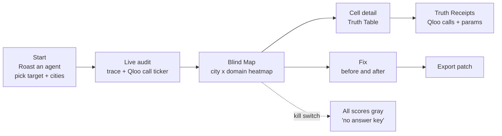

| View | Must show |
|---|---|
| Start | One-click demo target; precomputed results load instantly |
| Blind Map | Score per cell with confidence; thin cells marked; confirmed blindspots highlighted |
| Truth Table | Agent alone, agent with Qloo, Qloo's answer key, side by side |
| Truth Receipts | Every Qloo call behind a number: endpoint, params, result count, `served_from` |
| Kill switch | Toggling it grays out scores for this viewer only |
| Before and after | Per-cell and overall delta, held-out result too |
| Data label | Always visible; from `served_from` and `synthetic` (above), never "live" for stored data |

Mobile width works, with no horizontal scroll. Cold start shows a "waking up" state, not a blank page.

---

## 14. Data model

SQLite. Tables marked Planned arrive with their phase.

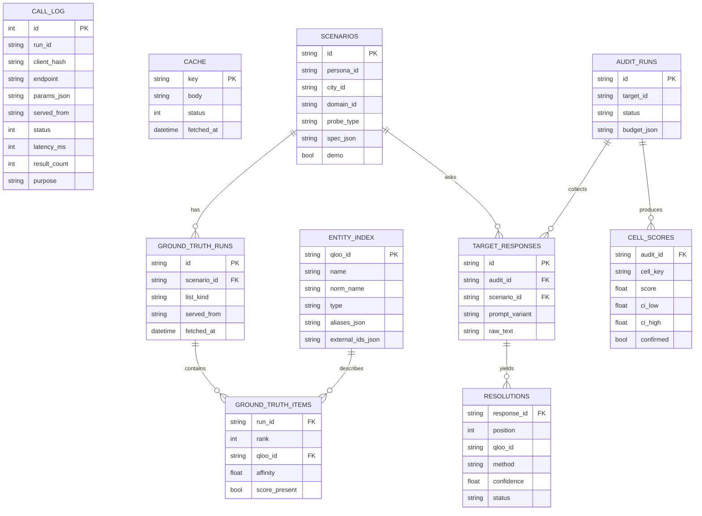

Storage settings: WAL mode, busy timeout, indexes on lookup columns, one connection per task or a
serialized writer.

**Answer keys (built, #18).** The ground-truth tables live in their own file,
`data/groundtruth.sqlite` (gitignored: it holds Qloo names), next to the Qloo cache. A run is keyed
by its spec's content key, not by scenario, so a spec shared by many scenarios is fetched and stored
once; `scenarios.local_key` and `global_key` point at runs. `scenario_status` is the per-scenario
checkpoint and disposition: `pending`, then `fetched` (runs stored, not yet checked, unreadable), then `done | thin | excluded | empty`, or `failed`. Only `done`, `thin` and `excluded` are readable. Read only through
`groundtruth.get_answer_key()`. Decisions: D41.

**Target answers (built, #27).** `target_responses_cache` lives in `data/targets.sqlite` (gitignored:
it holds model text): one row per (target id, model id, prompt hash, temperature, max_tokens) with the
outcome and the parsed `TargetResponse`, never a key. The audit's `TARGET_RESPONSES` table (Phase 4)
links runs to these answers. Decisions: D50.

---

## 15. Run modes and data distribution

| Mode | Key | Data | Who |
|---|---|---|---|
| Hosted demo | Server env var | Real private snapshot, live within budget | Judges (primary) |
| Local, own key | `.env` | Live + cache | Developers, judges with keys |
| Local, no key | None | Synthetic snapshot, offline | Anyone; the only mode after keys expire |

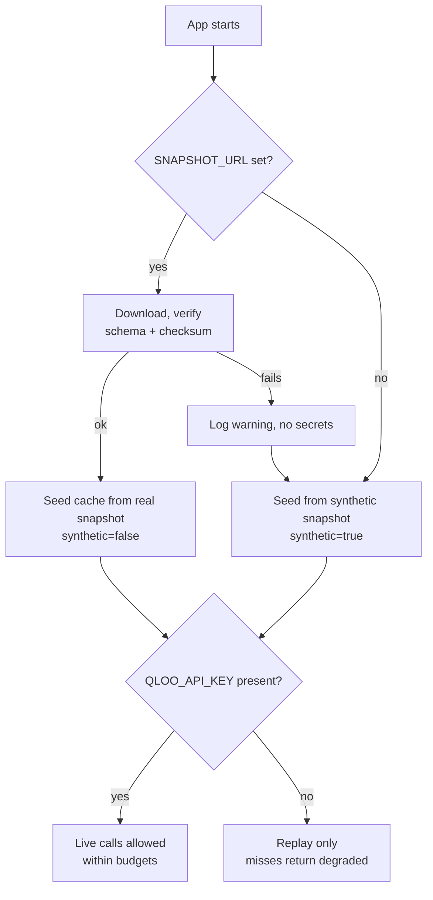

**Status (Phase 1).** The diagram above is the Phase 2 design. Today the service seeds an empty cache
from one snapshot file at `QLOO_SNAPSHOT_PATH` (on Render, a Secret File); there is no `SNAPSHOT_URL`
download and no bundled synthetic snapshot yet, so a fresh no-key clone answers `degraded` for
anything uncached. `scripts/export_snapshot.py --synthetic` builds a synthetic one for offline development.

What's in git and what isn't: see [ADR 0002](adr/0002-no-real-qloo-data-in-git.md).

---

## 16. Security and threat model

| Threat | Where | Mitigation | Verified by |
|---|---|---|---|
| Key leak | Logs, errors, cache, `/status`, Docker layers, git | Server-side only; redaction filter; scans of tree, history, image | Redaction tests, gitleaks, mutation M1/M6 |
| Quota exhaustion | Public demo | Budgets ×3, demo reserve, per-IP limit, breaker, precompute | Budget and 50-concurrent tests |
| Slow-loris or hang | Qloo slow or 429 | Per-request deadline, breaker | Always-429 fake-server test |
| Spoofed client identity | `X-Forwarded-For` | Trust forwarded headers only from the host proxy | Spoofing black-box test |
| Privacy | Request logs | Salted IP hashes only; no accounts; no personal data to Qloo | Raw-IP leak test, mutation M9 |
| Prompt injection | Target output | Treated as data; escaped; never executed; not fed to tools unfiltered | Fuzz tests (Phase 3+) |
| SSRF | Bring-your-own endpoint | Off by default; block private, loopback and link-local ranges | Unit tests (Phase 3) |
| Cross-viewer interference | Kill switch | Per-request flag, not global state | Isolation test, mutation M2 |
| Data terms | Public repo | No real Qloo data in git; synthetic public snapshot | History scan |
| Supply chain | Dependencies, Actions | Lockfile, pip-audit, Dependabot, CodeQL when public | CI |

---

## 17. Observability

- **Call log** for every Qloo call (purpose: `app`, `audit`, `recon`, `coverage`, `smoke`, `script`), queryable by run.
- **Audit events** streamed to the UI and stored for replay.
- **`/api/qloo/status`** for budgets, breaker and snapshot state, with no secrets.
- **Structured logs** with redaction; request id and client hash on each line.
- **Counters** reported in phase reports: live calls by purpose, cache hit rate, match rate, p95 latency.

---

## 18. Testing strategy

| Layer | Tool | Rule |
|---|---|---|
| Unit | pytest | Offline, no key; fixtures tiny and synthetic or trimmed |
| HTTP mocking | respx | All Qloo behaviors simulated, including both error shapes and silent ignore |
| Fake Qloo server | FastAPI under `data/audit/` | 401, 403, 404, 429 with and without `Retry-After`, 5xx, slow, malformed |
| Mutation spot-checks | Manual in a temp copy | Each security property must have a test that fails when it's removed |
| Black-box service | httpx against uvicorn | Concurrency, fuzzing, spoofing, `/status` leak check |
| Calibration | pytest | Synthetic targets produce the expected scores (Section 9) |
| Live | `@pytest.mark.live`, `QLOO_LIVE_TESTS=1` | Opt-in, never in CI |
| Cross-platform | CI on Ubuntu and Windows | UTF-8 console safety, path handling |
| Fresh clone | CI job | No `.env`, replay mode, `/healthz` responds |

---

## 19. Phase plan: what each phase must achieve

Dates are milestone targets; submission is 2026-10-28.

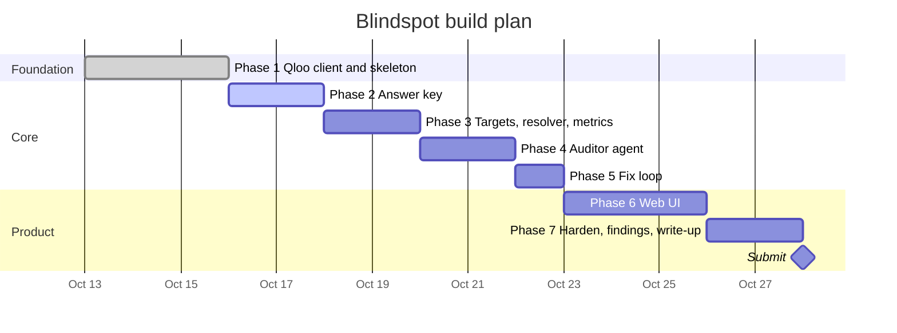

What each phase adds to the system:

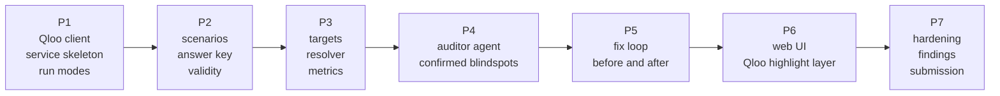

### Phase 1: Foundation (done 2026-10-16)

| | |
|---|---|
| Goal | Know what Qloo really does and reach it safely from a multi-user app. |
| Delivers | Qloo client (Section 6), FastAPI skeleton, three run modes, recon E1 to E11, coverage matrix, `config/` for cities and domains, offline tests with mutation checks. |
| Exit criteria | Real call works; reality doc and coverage matrix complete; budgets, breaker, deadline, kill switch, replay tested; fresh clone works with no key; no secrets anywhere. |
| Outcome | All 6 cities rich in all 4 domains; city overlap ≤ 0.12; scores need a taste signal for places; `videogame` spelling. |
| Open | Docker image scan, Render deploy, public repo (maintainer). |

### Phase 2: Answer key (target 2026-10-18)

| | |
|---|---|
| Goal | Build the exam and a trustworthy answer key, and prove it's trustworthy. |
| Delivers | Parameter promotion with evidence; experiments E12 (depth), E13 (place query shape), E14 (candidate scoring with taste signal), E15 (persona sensitivity); personas and probe types in config; locked IDs; 80 to 120 deterministic scenarios with a 30 to 40 demo subset (≥ 8 swap pairs); resumable ground-truth build; `entity_index`; validity V1 to V9; `metrics_design.md`; coverage probe for any location; synthetic public and private real snapshots. |
| Exit criteria | Every parameter used is VERIFIED; every cell dispositioned KEEP, DOWNGRADE or DROP; discrimination numbers per domain; fresh clone serves synthetic ground truth offline; under 1,200 live calls. |
| Not in scope | LLM calls, metrics code, UI. |
| Key risk | E14 fails, so recommendations outside the answer key can't be scored directly. Fallback: rank-only membership plus existence checks. |

### Phase 3: Targets, resolver, metrics (target 2026-10-20)

| | |
|---|---|
| Goal | Turn agent output into honest numbers. |
| Delivers | Target adapters with structured output and response cache; resolver (Section 8.2) with match-rate reporting; metrics (Section 9); calibration targets; per-scenario scoring CLI. |
| Exit criteria | All calibration tests pass; match rate reported per domain and script and compared with the V8 ceiling; a CLI audit of two preloaded models runs end to end. |
| Key risk | Low match rate in non-Latin scripts. Mitigation: aliases in `entity_index`, show confidence, exclude unresolved from penalties. |

### Phase 4: Auditor agent (target 2026-10-22)

| | |
|---|---|
| Goal | Make it agentic: find and confirm weak cells, not just run a fixed grid. |
| Delivers | State machine (Section 10), cell selection, bootstrap confirmation, budgets for calls, tokens and time, event stream, audit API routes. |
| Exit criteria | Audit of two models finds confirmed blindspots with confidence intervals; stops cleanly at each budget; replays from stored events. |
| Key risk | Too many probes per cell for the quota. Mitigation: cache target responses, cap probes, precompute the demo. |

### Phase 5: Fix loop (target 2026-10-23)

| | |
|---|---|
| Goal | Show Qloo closes the gap, honestly. |
| Delivers | Qloo-grounded target wrapper, same-exam re-run, held-out comparison, per-cell delta, prompt + MCP config export. |
| Exit criteria | Before and after numbers recorded for the demo targets, including held-out cells, reported even if the gain is modest. |
| Key risk | Gains only on scenarios the fix memorized. Mitigation: held-out set. |

### Phase 6: Web UI (target 2026-10-26)

| | |
|---|---|
| Goal | A stranger understands it in 90 seconds. |
| Delivers | Views in Section 13, in order; data label; cold-start state; mobile layout. |
| Exit criteria | Someone who hasn't seen it runs the demo end to end with no instructions, on desktop and phone. |
| Key risk | Polish eats the schedule. Mitigation: Blind Map, Truth Table, receipts and kill switch first. |

### Phase 7: Harden, findings, submission (target 2026-10-27 to 28)

| | |
|---|---|
| Goal | Ship something that can't embarrass us in front of judges. |
| Delivers | Precomputed demo audits and leaderboard; abuse and quota hardening; blind user test (15 to 20 people); findings write-up; Devpost description; README; screenshots. |
| Exit criteria | All submission requirements met (hosted demo, public repo, description, license in About); tested from a fresh browser, a phone and another network. |

**Cut order if behind:** score-regression GitHub Action, leaderboard, live call ticker, full MCP
server (keep the exported config), freshness and audience probes. **Never cut:** calibration tests,
Truth Table, kill switch, Truth Receipts.

---

## 20. Known limits, non-goals and open questions

**Limits**

- Qloo is a strong proxy for taste, not absolute truth. Blindspot measures gaps against Qloo's view.
- Free-text matching is noisy, especially across scripts; the match rate is always shown.
- The hackathon environment may lack data for some places; those cells aren't scored.
- After keys expire, the public repo runs on synthetic data only.

**Non-goals**

- Ranking cultures or saying which taste is "better".
- Inferring anything about individual users; there are no accounts and no personal data.
- Identity-based audience probing by default (opt-in, flagged, excluded from the demo).
- Replacing Qloo or building a general recommender.

**Open questions**

| Question | Decides | Owner |
|---|---|---|
| May a minimal real snapshot be committed? | ADR 0002 | Qloo Discord answer |
| Is `videogame` or `video_game` correct long-term? | ADR 0003 | Qloo Discord answer |
| Does candidate scoring work with a taste signal (E14)? | How out-of-key recommendations are scored | Phase 2 |
| Real maximum `take`? | Answer-key depth and coverage thresholds | Phase 2 (E12) |
| Which private storage for the real snapshot? | Hosted demo reliability | Maintainer |
