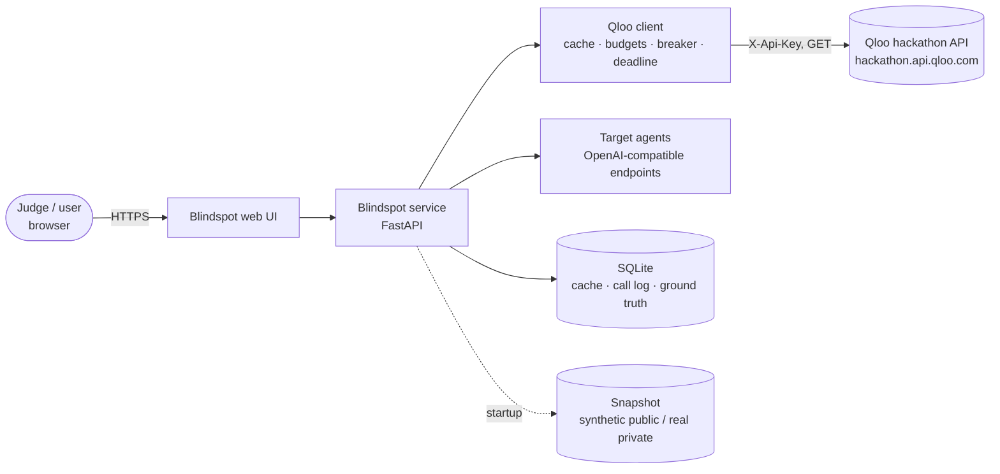
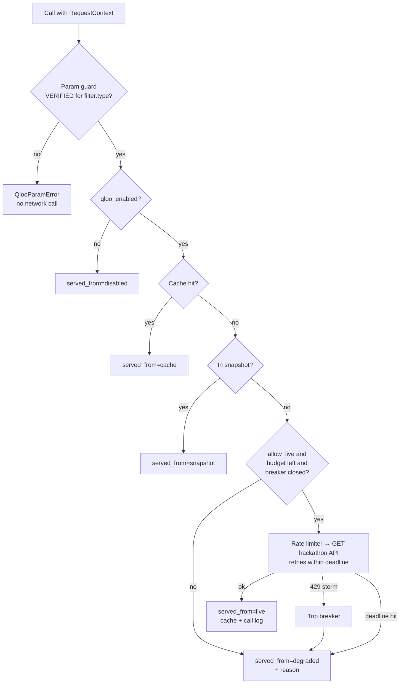
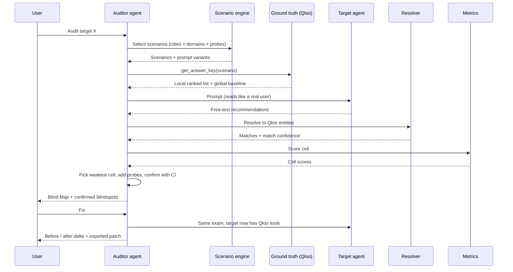

# Architecture

Status: Phase 1 complete (Qloo client, service skeleton, run modes). Phases 2 to 6 describe the
planned design. Sections marked **Planned** don't exist in code yet.

## 1. The idea in one paragraph

An AI agent recommending restaurants, music or brands guesses from the average of the internet, so
it tends to give everyone the same famous answers. Qloo knows what a given audience in a given place
actually loves, from anonymized behavior. Blindspot uses Qloo as an **answer key**: it asks the
target agent the same question a real user would, maps the agent's answers to Qloo entities, scores
how far they are from Qloo's ranked answer, finds the worst cells, and then re-runs the same exam
with the agent grounded in Qloo to show the improvement.

Without Qloo there is no answer key, so the app can't produce a score. The **kill switch** in the UI
makes that visible.

## 2. System context

Trust boundaries:

- The Qloo key exists only in server-side environment variables. It never reaches the browser.
- Target-agent output and any user-supplied text are untrusted data.
- Real Qloo data never leaves the server except as rendered results in the hosted demo.

## 3. Components

| Component | Location | Phase | What it does |
|---|---|---|---|
| Config | `config/*.yaml` | 1–2 | Cities, domains, personas, probe types as validated data |
| Qloo client | `src/blindspot/qloo/` | 1 | All Qloo access: typed requests, param guard, cache, call log, retries, rate limit, budgets, breaker, deadline, kill switch, replay |
| Service | `src/blindspot/service/` | 1 | FastAPI app: `/healthz`, `/api/qloo/status`, guarded endpoints, per-IP limits, CORS |
| Scenario engine | `src/blindspot/scenarios/` | 2 · Planned | Deterministic persona × place × domain × probe-type exams with neutral prompt variants |
| Ground truth | `src/blindspot/groundtruth/` | 2 · Planned | Qloo answer key per scenario (local list + global baseline), `entity_index`, `get_answer_key()` |
| Target adapters | `src/blindspot/targets/` | 3 · Planned | Call OpenAI-compatible models with a fixed prompt, parse structured recommendations |
| Entity resolver | `src/blindspot/resolve/` | 3 · Planned | Map free-text recommendations to Qloo entities (offline index first, `/search` second); report match rate |
| Metrics | `src/blindspot/metrics/` | 3 · Planned | Taste-fit, famous-vs-local gap, swap sameness, phantom rate, combined Blindspot Score |
| Auditor agent | `src/blindspot/auditor/` | 4 · Planned | Plan → probe → score → find weakest cell → drill down → confirm with confidence intervals → report |
| Fix loop | `src/blindspot/fix/` | 5 · Planned | Wrap the target with Qloo tools, re-run the same exam, compute the delta, export prompt + MCP config |
| Web UI | `web/` | 6 · Planned | Blind Map, Truth Table, Truth Receipts, kill switch, before/after, "Roast an agent" |

## 4. Qloo client: request path

Every Qloo call takes a `RequestContext(client_id, run_id, qloo_enabled, allow_live)`. `client_id` is
a salted hash of the requester IP.

Guarantees:

- **Budgets** at three scopes (global daily, per-client hourly, per-run) plus a reserved slice for
  demo-critical calls.
- **Deadline** per web request (default 8 s) covers resolution, retries and backoff. Backoff never
  sleeps past the deadline.
- **Circuit breaker** shared by all callers, so a 429 storm doesn't multiply.
- **Call log** row for every call: run id, client id hash, endpoint, params, `served_from`, status,
  latency, result count, purpose (`app`, `recon`, `coverage`, `audit`). Powers Truth Receipts.
- **Redaction**: the key is masked in logs, errors, the cache, the call log and `/status`.

## 5. Audit pipeline (Planned, Phases 2 to 5)

## 6. Metrics (Planned, Phase 3)

Primary measures are rank-based, because place scores only exist with a taste signal and scores
aren't comparable across queries ([ADR 0001](adr/0001-rank-based-metrics.md)).

| Metric | Question it answers | Basis |
|---|---|---|
| Taste-fit | Do the agent's picks appear in Qloo's top-k for this audience here? | overlap@k, rank-weighted hits |
| Famous-vs-local gap | Does it default to globally popular picks? | local list vs global baseline rank |
| Swap sameness | Does it change its answer when only the city changes? | Jaccard between the agent's two lists |
| Phantom rate | Does it name things that don't exist? | no Qloo match, no existence evidence |
| Blindspot Score | Overall, 0 to 100 | weighted combination, refused on thin cells |

Calibration tests the metrics must pass: a "Qloo copy" target scores high, a "global top-10 for
everyone" target scores low, a random target scores near zero.

## 7. Data and storage

| Data | Where | In git? |
|---|---|---|
| Qloo response cache, call log | `data/qloo_cache.sqlite` | No |
| Raw recon recordings | `data/raw/` | No |
| Ground truth, `entity_index` | SQLite under `data/` | No |
| Real demo snapshot | `data/private/` → private storage, loaded via `SNAPSHOT_URL` | No |
| Synthetic demo snapshot | `data/snapshot/` (synthetic, labeled) | Yes |
| Resolved seed IDs | `config/resolved_ids.lock.json` (IDs + our query text only) | Yes |
| Test fixtures | `tests/fixtures/` (tiny, trimmed or synthetic) | Yes |

## 8. Run modes

| Mode | Who | Key | Data |
|---|---|---|---|
| Hosted demo | Judges (primary) | Server env var | Real private snapshot + live within budget |
| Local, own key | Developers, judges with a key | `.env` | Live + cache |
| Local, no key | Anyone, and after keys are deactivated | None | Synthetic snapshot, offline |

Hosting: Render free tier via `render.yaml`. It sleeps when idle and its disk is ephemeral, so the
service seeds its cache from the snapshot at startup and never rebuilds ground truth on boot unless
`WARM_ON_BOOT=true` within its own capped budget.

## 9. Security

See [SECURITY.md](../SECURITY.md). Key points: server-side key only, redaction everywhere, salted IP
hashes, per-IP and per-client limits, forwarded headers trusted only from the host proxy, request
deadlines, escaped output, dependency audit in CI, secret scan of tree, history and Docker image.

## 10. Known limits

- Qloo is a strong proxy for taste, not absolute truth. Blindspot reports gaps against Qloo's view.
- Matching free text to Qloo entities is noisy, especially across scripts. The match rate is shown.
- The hackathon environment may lack data for some places. Thin or empty cells are not scored.
- Keys stop working after judging, so long-term the repo runs on synthetic data only.
