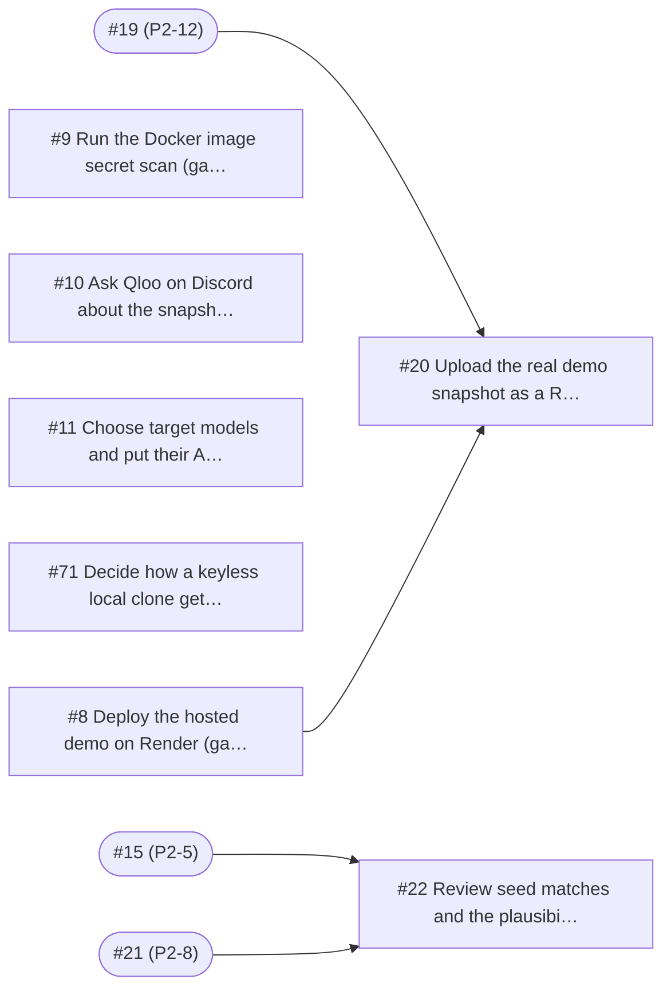
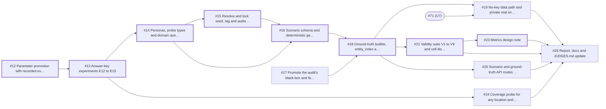
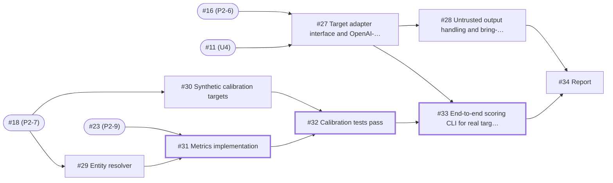
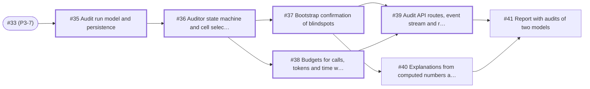
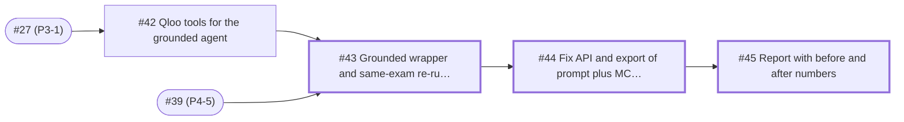
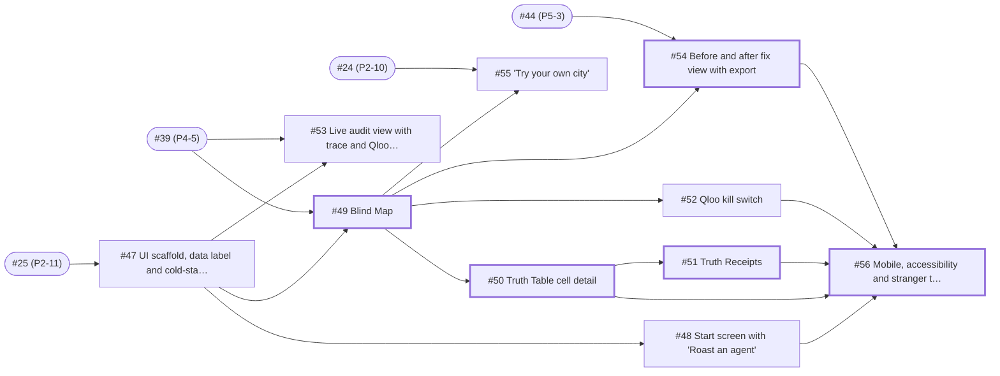
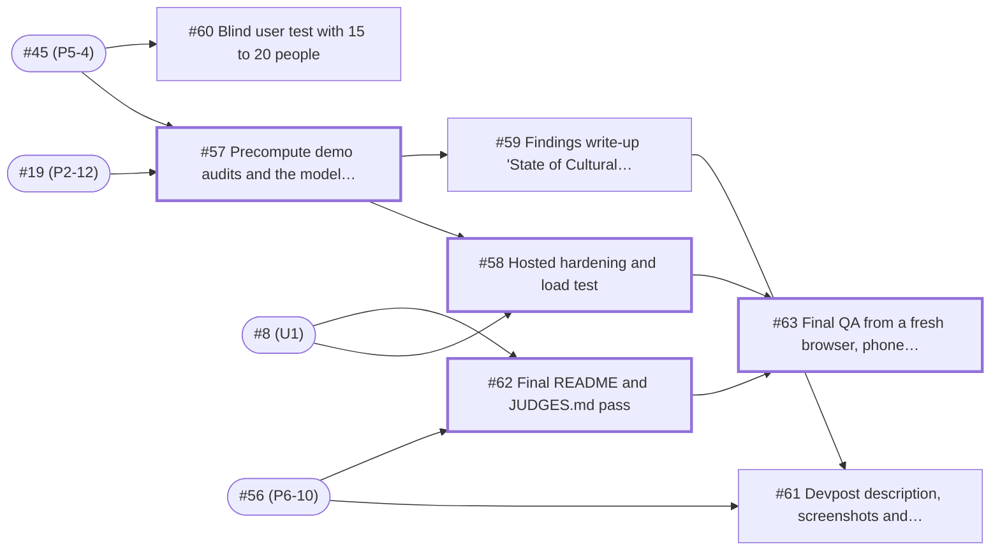
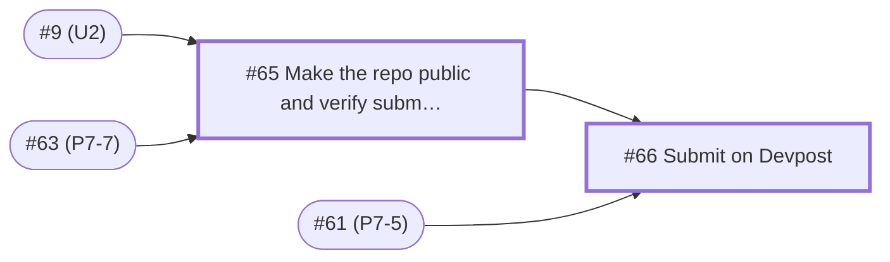

# Issue guide: what to work on, in what order

Every planned task from now to submission is a GitHub issue. This guide says which to pick up first, what blocks what, and what can run in parallel. It's generated from the same data used to create the issues, so numbers match. GitHub also shows each issue's **Blocked by** and **Blocking** links in its sidebar.

- **63 issues**, **85 dependency links**, 9 milestones
- Phase scope and exit criteria: [architecture.md, Section 19](architecture.md#19-phase-plan-what-each-phase-must-achieve)
- Schedule and status: [roadmap.md](roadmap.md)

## How to read the labels

| Label | Meaning |
|---|---|
| `P0` | Critical path or required to submit; never cut |
| `P1` | Needed for a strong submission; cut only in an emergency |
| `P2` | Nice to have; first to cut |
| `critical-path` / ⭐ | Zero slack: on a longest dependency chain, so a delay here delays submission day |
| `size:S` / `size:M` / `size:L` | Up to about 2 hours / half a day / a day |
| `needs-user` | Only the maintainer can do it |
| `decision` | A choice is needed before dependent work starts |
| `stretch`, `deferred` | Backlog; not planned for the hackathon unless time is left |
| `phase-N`, `ui`, `llm`, `qloo-api`, `security`, `judge-experience`, `docs` | Area |

## Start here (unblocked right now)

| Issue | Title | Who |
|---|---|---|
| [#8](https://github.com/nexuszephyr/Blindspot/issues/8) | Deploy the hosted demo on Render (gate 11) | Maintainer |
| [#9](https://github.com/nexuszephyr/Blindspot/issues/9) | Run the Docker image secret scan (gates 9 and 10) | Maintainer |
| [#10](https://github.com/nexuszephyr/Blindspot/issues/10) | Ask Qloo on Discord about the snapshot, quota and `videogame` | Maintainer |
| [#11](https://github.com/nexuszephyr/Blindspot/issues/11) | Choose target models and put their API keys on the host | Maintainer |
| [#12](https://github.com/nexuszephyr/Blindspot/issues/12) | Parameter promotion with recorded evidence | Claude Code / dev |
| [#17](https://github.com/nexuszephyr/Blindspot/issues/17) | Promote the audit's black-box and fake-Qloo tests into the permanent suite | Claude Code / dev |
| [#71](https://github.com/nexuszephyr/Blindspot/issues/71) | Decide how a keyless local clone gets data (D7) | Maintainer |

Do [#8](https://github.com/nexuszephyr/Blindspot/issues/8) (Render), [#11](https://github.com/nexuszephyr/Blindspot/issues/11) (target models and keys) and [#71](https://github.com/nexuszephyr/Blindspot/issues/71) (no-key data decision) first: hosting problems need time to surface, Phase 3 can't start without target models, and the snapshot work waits on the decision. On the code side, start [#12](https://github.com/nexuszephyr/Blindspot/issues/12) and [#17](https://github.com/nexuszephyr/Blindspot/issues/17) in parallel.

## Critical path

The longest chain of dependencies from today to submission. Any slip on these issues slips the deadline; everything else has slack.

[#12](https://github.com/nexuszephyr/Blindspot/issues/12) → [#13](https://github.com/nexuszephyr/Blindspot/issues/13) → [#14](https://github.com/nexuszephyr/Blindspot/issues/14) → [#15](https://github.com/nexuszephyr/Blindspot/issues/15) → [#16](https://github.com/nexuszephyr/Blindspot/issues/16) → [#18](https://github.com/nexuszephyr/Blindspot/issues/18) → [#21](https://github.com/nexuszephyr/Blindspot/issues/21) → [#23](https://github.com/nexuszephyr/Blindspot/issues/23) → [#31](https://github.com/nexuszephyr/Blindspot/issues/31) → [#32](https://github.com/nexuszephyr/Blindspot/issues/32) → [#33](https://github.com/nexuszephyr/Blindspot/issues/33) → [#35](https://github.com/nexuszephyr/Blindspot/issues/35) → [#36](https://github.com/nexuszephyr/Blindspot/issues/36) → [#37](https://github.com/nexuszephyr/Blindspot/issues/37) → [#39](https://github.com/nexuszephyr/Blindspot/issues/39) → [#43](https://github.com/nexuszephyr/Blindspot/issues/43) → [#44](https://github.com/nexuszephyr/Blindspot/issues/44) → [#45](https://github.com/nexuszephyr/Blindspot/issues/45) → [#57](https://github.com/nexuszephyr/Blindspot/issues/57) → [#58](https://github.com/nexuszephyr/Blindspot/issues/58) → [#63](https://github.com/nexuszephyr/Blindspot/issues/63) → [#65](https://github.com/nexuszephyr/Blindspot/issues/65) → [#66](https://github.com/nexuszephyr/Blindspot/issues/66)

These are tied for longest, so they have zero slack too and carry ⭐ below: [#38](https://github.com/nexuszephyr/Blindspot/issues/38) Budgets for calls, tokens and time with clean stops, [#49](https://github.com/nexuszephyr/Blindspot/issues/49) Blind Map, [#50](https://github.com/nexuszephyr/Blindspot/issues/50) Truth Table cell detail, [#51](https://github.com/nexuszephyr/Blindspot/issues/51) Truth Receipts, [#54](https://github.com/nexuszephyr/Blindspot/issues/54) Before and after fix view with export, [#56](https://github.com/nexuszephyr/Blindspot/issues/56) Mobile, accessibility and stranger test, [#62](https://github.com/nexuszephyr/Blindspot/issues/62) Final README and JUDGES.md pass.

| Step | Issue | Title | Size | Phase deadline |
|---|---|---|---|---|
| 1 | [#12](https://github.com/nexuszephyr/Blindspot/issues/12) | Parameter promotion with recorded evidence | M | 2026-10-18 |
| 2 | [#13](https://github.com/nexuszephyr/Blindspot/issues/13) | Answer-key experiments E12 to E15 | M | 2026-10-18 |
| 3 | [#14](https://github.com/nexuszephyr/Blindspot/issues/14) | Personas, probe types and domain query shapes as config | M | 2026-10-18 |
| 4 | [#15](https://github.com/nexuszephyr/Blindspot/issues/15) | Resolve and lock seed, tag and audience IDs | S | 2026-10-18 |
| 5 | [#16](https://github.com/nexuszephyr/Blindspot/issues/16) | Scenario schema and deterministic generator | M | 2026-10-18 |
| 6 | [#18](https://github.com/nexuszephyr/Blindspot/issues/18) | Ground-truth builder, `entity_index` and `get_answer_key()` | L | 2026-10-18 |
| 7 | [#21](https://github.com/nexuszephyr/Blindspot/issues/21) | Validity suite V1 to V9 and cell dispositions | M | 2026-10-18 |
| 8 | [#23](https://github.com/nexuszephyr/Blindspot/issues/23) | Metrics design note | S | 2026-10-18 |
| 9 | [#31](https://github.com/nexuszephyr/Blindspot/issues/31) | Metrics implementation | M | 2026-10-20 |
| 10 | [#32](https://github.com/nexuszephyr/Blindspot/issues/32) | Calibration tests pass | S | 2026-10-20 |
| 11 | [#33](https://github.com/nexuszephyr/Blindspot/issues/33) | End-to-end scoring CLI for real targets | M | 2026-10-20 |
| 12 | [#35](https://github.com/nexuszephyr/Blindspot/issues/35) | Audit run model and persistence | M | 2026-10-22 |
| 13 | [#36](https://github.com/nexuszephyr/Blindspot/issues/36) | Auditor state machine and cell selection | L | 2026-10-22 |
| 14 | [#37](https://github.com/nexuszephyr/Blindspot/issues/37) | Bootstrap confirmation of blindspots | M | 2026-10-22 |
| 15 | [#39](https://github.com/nexuszephyr/Blindspot/issues/39) | Audit API routes, event stream and receipts | M | 2026-10-22 |
| 16 | [#43](https://github.com/nexuszephyr/Blindspot/issues/43) | Grounded wrapper and same-exam re-run with held-out set | L | 2026-10-23 |
| 17 | [#44](https://github.com/nexuszephyr/Blindspot/issues/44) | Fix API and export of prompt plus MCP config | S | 2026-10-23 |
| 18 | [#45](https://github.com/nexuszephyr/Blindspot/issues/45) | Report with before and after numbers | S | 2026-10-23 |
| 19 | [#57](https://github.com/nexuszephyr/Blindspot/issues/57) | Precompute demo audits and the model leaderboard | M | 2026-10-27 |
| 20 | [#58](https://github.com/nexuszephyr/Blindspot/issues/58) | Hosted hardening and load test | S | 2026-10-27 |
| 21 | [#63](https://github.com/nexuszephyr/Blindspot/issues/63) | Final QA from a fresh browser, phone and another network | S | 2026-10-27 |
| 22 | [#65](https://github.com/nexuszephyr/Blindspot/issues/65) | Make the repo public and verify submission requirements | S | 2026-10-28 |
| 23 | [#66](https://github.com/nexuszephyr/Blindspot/issues/66) | Submit on Devpost | S | 2026-10-28 |

```mermaid
flowchart LR
    P2_2["#12 Parameter promotion with recorded ev…"]
    P2_3["#13 Answer-key experiments E12 to E15"]
    P2_4["#14 Personas, probe types and domain que…"]
    P2_5["#15 Resolve and lock seed, tag and audie…"]
    P2_6["#16 Scenario schema and deterministic ge…"]
    P2_7["#18 Ground-truth builder, entity_index a…"]
    P2_8["#21 Validity suite V1 to V9 and cell dis…"]
    P2_9["#23 Metrics design note"]
    P3_5["#31 Metrics implementation"]
    P3_6["#32 Calibration tests pass"]
    P3_7["#33 End-to-end scoring CLI for real targ…"]
    P4_1["#35 Audit run model and persistence"]
    P4_2["#36 Auditor state machine and cell selec…"]
    P4_3["#37 Bootstrap confirmation of blindspots"]
    P4_5["#39 Audit API routes, event stream and r…"]
    P5_2["#43 Grounded wrapper and same-exam re-ru…"]
    P5_3["#44 Fix API and export of prompt plus MC…"]
    P5_4["#45 Report with before and after numbers"]
    P7_1["#57 Precompute demo audits and the model…"]
    P7_2["#58 Hosted hardening and load test"]
    P7_7["#63 Final QA from a fresh browser, phone…"]
    S1["#65 Make the repo public and verify subm…"]
    S2["#66 Submit on Devpost"]
    P2_2 --> P2_3
    P2_3 --> P2_4
    P2_4 --> P2_5
    P2_5 --> P2_6
    P2_6 --> P2_7
    P2_7 --> P2_8
    P2_8 --> P2_9
    P2_9 --> P3_5
    P3_5 --> P3_6
    P3_6 --> P3_7
    P3_7 --> P4_1
    P4_1 --> P4_2
    P4_2 --> P4_3
    P4_3 --> P4_5
    P4_5 --> P5_2
    P5_2 --> P5_3
    P5_3 --> P5_4
    P5_4 --> P7_1
    P7_1 --> P7_2
    P7_2 --> P7_7
    P7_7 --> S1
    S1 --> S2
```

## Parallel tracks

If more than one person (or Claude Code session) is working, split like this. Each track only waits on the hand-offs listed.

| Track | Issues | Waits on |
|---|---|---|
| A: Core pipeline | Phase 2 → 3 → 4 → 5 critical path | nothing; this is the critical path |
| B: Hardening and API | [#17](https://github.com/nexuszephyr/Blindspot/issues/17), [#24](https://github.com/nexuszephyr/Blindspot/issues/24), [#25](https://github.com/nexuszephyr/Blindspot/issues/25), [#19](https://github.com/nexuszephyr/Blindspot/issues/19), [#28](https://github.com/nexuszephyr/Blindspot/issues/28), [#38](https://github.com/nexuszephyr/Blindspot/issues/38) | [#13](https://github.com/nexuszephyr/Blindspot/issues/13), [#18](https://github.com/nexuszephyr/Blindspot/issues/18) |
| C: UI | [#47](https://github.com/nexuszephyr/Blindspot/issues/47) on mock data, then the rest of Phase 6 | [#25](https://github.com/nexuszephyr/Blindspot/issues/25) to start; [#39](https://github.com/nexuszephyr/Blindspot/issues/39) for real data |
| D: Maintainer | [#8](https://github.com/nexuszephyr/Blindspot/issues/8), [#9](https://github.com/nexuszephyr/Blindspot/issues/9), [#10](https://github.com/nexuszephyr/Blindspot/issues/10), [#11](https://github.com/nexuszephyr/Blindspot/issues/11), [#71](https://github.com/nexuszephyr/Blindspot/issues/71), [#20](https://github.com/nexuszephyr/Blindspot/issues/20), [#22](https://github.com/nexuszephyr/Blindspot/issues/22), [#65](https://github.com/nexuszephyr/Blindspot/issues/65), [#66](https://github.com/nexuszephyr/Blindspot/issues/66) | [#21](https://github.com/nexuszephyr/Blindspot/issues/21) for [#22](https://github.com/nexuszephyr/Blindspot/issues/22); [#19](https://github.com/nexuszephyr/Blindspot/issues/19) and [#8](https://github.com/nexuszephyr/Blindspot/issues/8) for [#20](https://github.com/nexuszephyr/Blindspot/issues/20) |

## Day-by-day plan

| Date | Aim |
|---|---|
| Oct 16 (Fri) | Maintainer: [#8](https://github.com/nexuszephyr/Blindspot/issues/8), [#11](https://github.com/nexuszephyr/Blindspot/issues/11), [#71](https://github.com/nexuszephyr/Blindspot/issues/71), [#9](https://github.com/nexuszephyr/Blindspot/issues/9), [#10](https://github.com/nexuszephyr/Blindspot/issues/10). Code: [#12](https://github.com/nexuszephyr/Blindspot/issues/12), [#17](https://github.com/nexuszephyr/Blindspot/issues/17) |
| Oct 17 (Sat) | [#13](https://github.com/nexuszephyr/Blindspot/issues/13) → [#14](https://github.com/nexuszephyr/Blindspot/issues/14) → [#15](https://github.com/nexuszephyr/Blindspot/issues/15) → [#16](https://github.com/nexuszephyr/Blindspot/issues/16); start [#18](https://github.com/nexuszephyr/Blindspot/issues/18) |
| Oct 18 (Sun) | [#18](https://github.com/nexuszephyr/Blindspot/issues/18), [#21](https://github.com/nexuszephyr/Blindspot/issues/21), [#23](https://github.com/nexuszephyr/Blindspot/issues/23); side: [#24](https://github.com/nexuszephyr/Blindspot/issues/24), [#25](https://github.com/nexuszephyr/Blindspot/issues/25), [#19](https://github.com/nexuszephyr/Blindspot/issues/19); maintainer reviews [#22](https://github.com/nexuszephyr/Blindspot/issues/22) |
| Oct 19 (Mon) | [#27](https://github.com/nexuszephyr/Blindspot/issues/27), [#29](https://github.com/nexuszephyr/Blindspot/issues/29), [#30](https://github.com/nexuszephyr/Blindspot/issues/30); UI track starts [#47](https://github.com/nexuszephyr/Blindspot/issues/47) |
| Oct 20 (Tue) | [#31](https://github.com/nexuszephyr/Blindspot/issues/31), [#32](https://github.com/nexuszephyr/Blindspot/issues/32), [#33](https://github.com/nexuszephyr/Blindspot/issues/33), [#28](https://github.com/nexuszephyr/Blindspot/issues/28) |
| Oct 21 (Wed) | [#35](https://github.com/nexuszephyr/Blindspot/issues/35), [#36](https://github.com/nexuszephyr/Blindspot/issues/36) |
| Oct 22 (Thu) | [#37](https://github.com/nexuszephyr/Blindspot/issues/37), [#38](https://github.com/nexuszephyr/Blindspot/issues/38), [#39](https://github.com/nexuszephyr/Blindspot/issues/39); [#42](https://github.com/nexuszephyr/Blindspot/issues/42) in parallel |
| Oct 23 (Fri) | [#43](https://github.com/nexuszephyr/Blindspot/issues/43), [#44](https://github.com/nexuszephyr/Blindspot/issues/44); UI wires to real audits: [#49](https://github.com/nexuszephyr/Blindspot/issues/49) |
| Oct 24 (Sat) | [#48](https://github.com/nexuszephyr/Blindspot/issues/48), [#50](https://github.com/nexuszephyr/Blindspot/issues/50), [#51](https://github.com/nexuszephyr/Blindspot/issues/51), [#52](https://github.com/nexuszephyr/Blindspot/issues/52) |
| Oct 25 (Sun) | [#54](https://github.com/nexuszephyr/Blindspot/issues/54), [#53](https://github.com/nexuszephyr/Blindspot/issues/53), [#55](https://github.com/nexuszephyr/Blindspot/issues/55) |
| Oct 26 (Mon) | [#56](https://github.com/nexuszephyr/Blindspot/issues/56) stranger test; [#57](https://github.com/nexuszephyr/Blindspot/issues/57) precompute |
| Oct 27 (Tue) | [#58](https://github.com/nexuszephyr/Blindspot/issues/58), [#59](https://github.com/nexuszephyr/Blindspot/issues/59), [#61](https://github.com/nexuszephyr/Blindspot/issues/61), [#62](https://github.com/nexuszephyr/Blindspot/issues/62), [#63](https://github.com/nexuszephyr/Blindspot/issues/63) |
| Oct 28 (Wed) | [#65](https://github.com/nexuszephyr/Blindspot/issues/65) make public, [#66](https://github.com/nexuszephyr/Blindspot/issues/66) submit |
| Oct 29 to 30 | Buffer only. Devpost closes Oct 30. |

## Issues by phase

Within each phase, the order column is a valid working order: every issue comes after the issues that block it.

### Maintainer actions

Only you can do these: accounts, dashboards, decisions. Start U1 to U4 today; they block later work.

| Order | Issue | Key | Title | Blocked by | Size | Priority |
|---|---|---|---|---|---|---|
| 1 | [#8](https://github.com/nexuszephyr/Blindspot/issues/8) | `U1` | Deploy the hosted demo on Render (gate 11) | nothing | S | P0 |
| 2 | [#9](https://github.com/nexuszephyr/Blindspot/issues/9) | `U2` | Run the Docker image secret scan (gates 9 and 10) | nothing | S | P1 |
| 3 | [#10](https://github.com/nexuszephyr/Blindspot/issues/10) | `U3` | Ask Qloo on Discord about the snapshot, quota and `videogame` | nothing | S | P1 |
| 4 | [#11](https://github.com/nexuszephyr/Blindspot/issues/11) | `U4` | Choose target models and put their API keys on the host | nothing | S | P0 |
| 5 | [#71](https://github.com/nexuszephyr/Blindspot/issues/71) | `U7` | Decide how a keyless local clone gets data (D7) | nothing | S | P0 |
| 6 | [#20](https://github.com/nexuszephyr/Blindspot/issues/20) | `U5` | Upload the real demo snapshot as a Render secret file | [#19](https://github.com/nexuszephyr/Blindspot/issues/19), [#8](https://github.com/nexuszephyr/Blindspot/issues/8) | S | P1 |
| 7 | [#22](https://github.com/nexuszephyr/Blindspot/issues/22) | `U6` | Review seed matches and the plausibility sample | [#15](https://github.com/nexuszephyr/Blindspot/issues/15), [#21](https://github.com/nexuszephyr/Blindspot/issues/21) | S | P1 |

### Phase 2

Build the exam and a validated Qloo answer key. Due 2026-10-18.

| Order | Issue | Key | Title | Blocked by | Size | Priority |
|---|---|---|---|---|---|---|
| 1 | [#12](https://github.com/nexuszephyr/Blindspot/issues/12) ⭐ | `P2-2` | Parameter promotion with recorded evidence | nothing | M | P0 |
| 2 | [#17](https://github.com/nexuszephyr/Blindspot/issues/17) | `P2-1` | Promote the audit's black-box and fake-Qloo tests into the permanent suite | nothing | M | P0 |
| 3 | [#13](https://github.com/nexuszephyr/Blindspot/issues/13) ⭐ | `P2-3` | Answer-key experiments E12 to E15 | [#12](https://github.com/nexuszephyr/Blindspot/issues/12) | M | P0 |
| 4 | [#14](https://github.com/nexuszephyr/Blindspot/issues/14) ⭐ | `P2-4` | Personas, probe types and domain query shapes as config | [#13](https://github.com/nexuszephyr/Blindspot/issues/13) | M | P0 |
| 5 | [#24](https://github.com/nexuszephyr/Blindspot/issues/24) | `P2-10` | Coverage probe for any location and `GET /api/coverage` | [#13](https://github.com/nexuszephyr/Blindspot/issues/13) | M | P1 |
| 6 | [#15](https://github.com/nexuszephyr/Blindspot/issues/15) ⭐ | `P2-5` | Resolve and lock seed, tag and audience IDs | [#14](https://github.com/nexuszephyr/Blindspot/issues/14) | S | P0 |
| 7 | [#16](https://github.com/nexuszephyr/Blindspot/issues/16) ⭐ | `P2-6` | Scenario schema and deterministic generator | [#14](https://github.com/nexuszephyr/Blindspot/issues/14), [#15](https://github.com/nexuszephyr/Blindspot/issues/15) | M | P0 |
| 8 | [#18](https://github.com/nexuszephyr/Blindspot/issues/18) ⭐ | `P2-7` | Ground-truth builder, `entity_index` and `get_answer_key()` | [#16](https://github.com/nexuszephyr/Blindspot/issues/16), [#17](https://github.com/nexuszephyr/Blindspot/issues/17) | L | P0 |
| 9 | [#19](https://github.com/nexuszephyr/Blindspot/issues/19) | `P2-12` | No-key data path and private real snapshot | [#18](https://github.com/nexuszephyr/Blindspot/issues/18), [#71](https://github.com/nexuszephyr/Blindspot/issues/71) | M | P0 |
| 10 | [#21](https://github.com/nexuszephyr/Blindspot/issues/21) ⭐ | `P2-8` | Validity suite V1 to V9 and cell dispositions | [#18](https://github.com/nexuszephyr/Blindspot/issues/18) | M | P0 |
| 11 | [#25](https://github.com/nexuszephyr/Blindspot/issues/25) | `P2-11` | Scenario and ground-truth API routes and CLI | [#18](https://github.com/nexuszephyr/Blindspot/issues/18) | S | P1 |
| 12 | [#23](https://github.com/nexuszephyr/Blindspot/issues/23) ⭐ | `P2-9` | Metrics design note | [#21](https://github.com/nexuszephyr/Blindspot/issues/21) | S | P0 |
| 13 | [#26](https://github.com/nexuszephyr/Blindspot/issues/26) | `P2-13` | Report, docs and JUDGES.md update | [#21](https://github.com/nexuszephyr/Blindspot/issues/21), [#23](https://github.com/nexuszephyr/Blindspot/issues/23), [#24](https://github.com/nexuszephyr/Blindspot/issues/24), [#25](https://github.com/nexuszephyr/Blindspot/issues/25), [#19](https://github.com/nexuszephyr/Blindspot/issues/19) | S | P1 |

### Phase 3

Target adapters, resolver, metrics, calibration. Due 2026-10-20.

| Order | Issue | Key | Title | Blocked by | Size | Priority |
|---|---|---|---|---|---|---|
| 1 | [#27](https://github.com/nexuszephyr/Blindspot/issues/27) | `P3-1` | Target adapter interface and OpenAI-compatible client | [#16](https://github.com/nexuszephyr/Blindspot/issues/16), [#11](https://github.com/nexuszephyr/Blindspot/issues/11) | M | P0 |
| 2 | [#28](https://github.com/nexuszephyr/Blindspot/issues/28) | `P3-2` | Untrusted output handling and bring-your-own-endpoint guard | [#27](https://github.com/nexuszephyr/Blindspot/issues/27) | S | P1 |
| 3 | [#29](https://github.com/nexuszephyr/Blindspot/issues/29) | `P3-3` | Entity resolver | [#18](https://github.com/nexuszephyr/Blindspot/issues/18) | L | P0 |
| 4 | [#30](https://github.com/nexuszephyr/Blindspot/issues/30) | `P3-4` | Synthetic calibration targets | [#18](https://github.com/nexuszephyr/Blindspot/issues/18) | S | P0 |
| 5 | [#31](https://github.com/nexuszephyr/Blindspot/issues/31) ⭐ | `P3-5` | Metrics implementation | [#23](https://github.com/nexuszephyr/Blindspot/issues/23), [#29](https://github.com/nexuszephyr/Blindspot/issues/29) | M | P0 |
| 6 | [#32](https://github.com/nexuszephyr/Blindspot/issues/32) ⭐ | `P3-6` | Calibration tests pass | [#30](https://github.com/nexuszephyr/Blindspot/issues/30), [#31](https://github.com/nexuszephyr/Blindspot/issues/31) | S | P0 |
| 7 | [#33](https://github.com/nexuszephyr/Blindspot/issues/33) ⭐ | `P3-7` | End-to-end scoring CLI for real targets | [#27](https://github.com/nexuszephyr/Blindspot/issues/27), [#32](https://github.com/nexuszephyr/Blindspot/issues/32) | M | P0 |
| 8 | [#34](https://github.com/nexuszephyr/Blindspot/issues/34) | `P3-8` | Report | [#28](https://github.com/nexuszephyr/Blindspot/issues/28), [#33](https://github.com/nexuszephyr/Blindspot/issues/33) | S | P1 |

### Phase 4

The agent that finds and confirms blindspots. Due 2026-10-22.

| Order | Issue | Key | Title | Blocked by | Size | Priority |
|---|---|---|---|---|---|---|
| 1 | [#35](https://github.com/nexuszephyr/Blindspot/issues/35) ⭐ | `P4-1` | Audit run model and persistence | [#33](https://github.com/nexuszephyr/Blindspot/issues/33) | M | P0 |
| 2 | [#36](https://github.com/nexuszephyr/Blindspot/issues/36) ⭐ | `P4-2` | Auditor state machine and cell selection | [#35](https://github.com/nexuszephyr/Blindspot/issues/35) | L | P0 |
| 3 | [#37](https://github.com/nexuszephyr/Blindspot/issues/37) ⭐ | `P4-3` | Bootstrap confirmation of blindspots | [#36](https://github.com/nexuszephyr/Blindspot/issues/36) | M | P0 |
| 4 | [#38](https://github.com/nexuszephyr/Blindspot/issues/38) ⭐ | `P4-4` | Budgets for calls, tokens and time with clean stops | [#36](https://github.com/nexuszephyr/Blindspot/issues/36) | S | P0 |
| 5 | [#39](https://github.com/nexuszephyr/Blindspot/issues/39) ⭐ | `P4-5` | Audit API routes, event stream and receipts | [#37](https://github.com/nexuszephyr/Blindspot/issues/37), [#38](https://github.com/nexuszephyr/Blindspot/issues/38) | M | P0 |
| 6 | [#40](https://github.com/nexuszephyr/Blindspot/issues/40) | `P4-6` | Explanations from computed numbers and Qloo explainability | [#37](https://github.com/nexuszephyr/Blindspot/issues/37) | S | P1 |
| 7 | [#41](https://github.com/nexuszephyr/Blindspot/issues/41) | `P4-7` | Report with audits of two models | [#39](https://github.com/nexuszephyr/Blindspot/issues/39), [#40](https://github.com/nexuszephyr/Blindspot/issues/40) | S | P1 |

### Phase 5

Qloo-grounded re-run with honest before and after. Due 2026-10-23.

| Order | Issue | Key | Title | Blocked by | Size | Priority |
|---|---|---|---|---|---|---|
| 1 | [#42](https://github.com/nexuszephyr/Blindspot/issues/42) | `P5-1` | Qloo tools for the grounded agent | [#27](https://github.com/nexuszephyr/Blindspot/issues/27) | M | P0 |
| 2 | [#43](https://github.com/nexuszephyr/Blindspot/issues/43) ⭐ | `P5-2` | Grounded wrapper and same-exam re-run with held-out set | [#42](https://github.com/nexuszephyr/Blindspot/issues/42), [#39](https://github.com/nexuszephyr/Blindspot/issues/39) | L | P0 |
| 3 | [#44](https://github.com/nexuszephyr/Blindspot/issues/44) ⭐ | `P5-3` | Fix API and export of prompt plus MCP config | [#43](https://github.com/nexuszephyr/Blindspot/issues/43) | S | P1 |
| 4 | [#45](https://github.com/nexuszephyr/Blindspot/issues/45) ⭐ | `P5-4` | Report with before and after numbers | [#44](https://github.com/nexuszephyr/Blindspot/issues/44) | S | P1 |

### Phase 6

Blind Map, Truth Table, Truth Receipts, kill switch. Due 2026-10-26. The scaffold (#47) can start right after #25, against mock data.

| Order | Issue | Key | Title | Blocked by | Size | Priority |
|---|---|---|---|---|---|---|
| 1 | [#47](https://github.com/nexuszephyr/Blindspot/issues/47) | `P6-1` | UI scaffold, data label and cold-start state | [#25](https://github.com/nexuszephyr/Blindspot/issues/25) | M | P0 |
| 2 | [#48](https://github.com/nexuszephyr/Blindspot/issues/48) | `P6-2` | Start screen with 'Roast an agent' | [#47](https://github.com/nexuszephyr/Blindspot/issues/47) | S | P0 |
| 3 | [#49](https://github.com/nexuszephyr/Blindspot/issues/49) ⭐ | `P6-3` | Blind Map | [#47](https://github.com/nexuszephyr/Blindspot/issues/47), [#39](https://github.com/nexuszephyr/Blindspot/issues/39) | M | P0 |
| 4 | [#53](https://github.com/nexuszephyr/Blindspot/issues/53) | `P6-7` | Live audit view with trace and Qloo call ticker | [#47](https://github.com/nexuszephyr/Blindspot/issues/47), [#39](https://github.com/nexuszephyr/Blindspot/issues/39) | M | P1 |
| 5 | [#50](https://github.com/nexuszephyr/Blindspot/issues/50) ⭐ | `P6-4` | Truth Table cell detail | [#49](https://github.com/nexuszephyr/Blindspot/issues/49) | M | P0 |
| 6 | [#52](https://github.com/nexuszephyr/Blindspot/issues/52) | `P6-6` | Qloo kill switch | [#49](https://github.com/nexuszephyr/Blindspot/issues/49) | S | P0 |
| 7 | [#55](https://github.com/nexuszephyr/Blindspot/issues/55) | `P6-9` | 'Try your own city' | [#49](https://github.com/nexuszephyr/Blindspot/issues/49), [#24](https://github.com/nexuszephyr/Blindspot/issues/24) | S | P1 |
| 8 | [#51](https://github.com/nexuszephyr/Blindspot/issues/51) ⭐ | `P6-5` | Truth Receipts | [#50](https://github.com/nexuszephyr/Blindspot/issues/50) | S | P0 |
| 9 | [#54](https://github.com/nexuszephyr/Blindspot/issues/54) ⭐ | `P6-8` | Before and after fix view with export | [#49](https://github.com/nexuszephyr/Blindspot/issues/49), [#44](https://github.com/nexuszephyr/Blindspot/issues/44) | M | P0 |
| 10 | [#56](https://github.com/nexuszephyr/Blindspot/issues/56) ⭐ | `P6-10` | Mobile, accessibility and stranger test | [#48](https://github.com/nexuszephyr/Blindspot/issues/48), [#50](https://github.com/nexuszephyr/Blindspot/issues/50), [#51](https://github.com/nexuszephyr/Blindspot/issues/51), [#52](https://github.com/nexuszephyr/Blindspot/issues/52), [#54](https://github.com/nexuszephyr/Blindspot/issues/54) | S | P0 |

### Phase 7

Precompute, hardening, findings, write-up, final QA. Due 2026-10-27.

| Order | Issue | Key | Title | Blocked by | Size | Priority |
|---|---|---|---|---|---|---|
| 1 | [#57](https://github.com/nexuszephyr/Blindspot/issues/57) ⭐ | `P7-1` | Precompute demo audits and the model leaderboard | [#45](https://github.com/nexuszephyr/Blindspot/issues/45), [#19](https://github.com/nexuszephyr/Blindspot/issues/19) | M | P0 |
| 2 | [#60](https://github.com/nexuszephyr/Blindspot/issues/60) | `P7-4` | Blind user test with 15 to 20 people | [#45](https://github.com/nexuszephyr/Blindspot/issues/45) | S | P2 |
| 3 | [#58](https://github.com/nexuszephyr/Blindspot/issues/58) ⭐ | `P7-2` | Hosted hardening and load test | [#57](https://github.com/nexuszephyr/Blindspot/issues/57), [#8](https://github.com/nexuszephyr/Blindspot/issues/8) | S | P0 |
| 4 | [#59](https://github.com/nexuszephyr/Blindspot/issues/59) | `P7-3` | Findings write-up 'State of Cultural Blindness' | [#57](https://github.com/nexuszephyr/Blindspot/issues/57) | M | P1 |
| 5 | [#62](https://github.com/nexuszephyr/Blindspot/issues/62) ⭐ | `P7-6` | Final README and JUDGES.md pass | [#56](https://github.com/nexuszephyr/Blindspot/issues/56), [#8](https://github.com/nexuszephyr/Blindspot/issues/8) | S | P0 |
| 6 | [#61](https://github.com/nexuszephyr/Blindspot/issues/61) | `P7-5` | Devpost description, screenshots and architecture image | [#56](https://github.com/nexuszephyr/Blindspot/issues/56), [#59](https://github.com/nexuszephyr/Blindspot/issues/59) | M | P0 |
| 7 | [#63](https://github.com/nexuszephyr/Blindspot/issues/63) ⭐ | `P7-7` | Final QA from a fresh browser, phone and another network | [#58](https://github.com/nexuszephyr/Blindspot/issues/58), [#62](https://github.com/nexuszephyr/Blindspot/issues/62) | S | P0 |

### Submission

Make the repo public and submit by 2026-10-28.

| Order | Issue | Key | Title | Blocked by | Size | Priority |
|---|---|---|---|---|---|---|
| 1 | [#65](https://github.com/nexuszephyr/Blindspot/issues/65) ⭐ | `S1` | Make the repo public and verify submission requirements | [#9](https://github.com/nexuszephyr/Blindspot/issues/9), [#63](https://github.com/nexuszephyr/Blindspot/issues/63) | S | P0 |
| 2 | [#66](https://github.com/nexuszephyr/Blindspot/issues/66) ⭐ | `S2` | Submit on Devpost | [#65](https://github.com/nexuszephyr/Blindspot/issues/65), [#61](https://github.com/nexuszephyr/Blindspot/issues/61) | S | P0 |

### Backlog

Stretch goals and deferred items. Only touch these when everything P0 and P1 is done.

| Order | Issue | Key | Title | Blocked by | Size | Priority |
|---|---|---|---|---|---|---|
| 1 | [#67](https://github.com/nexuszephyr/Blindspot/issues/67) | `B1` | Deferred N3: synchronous SQLite inside async handlers | nothing | S | P2 |
| 2 | [#68](https://github.com/nexuszephyr/Blindspot/issues/68) | `B2` | Deferred N4: HTTP limiter clears all keys past 50,000 | nothing | S | P2 |
| 3 | [#69](https://github.com/nexuszephyr/Blindspot/issues/69) | `B3` | Chore: Starlette TestClient deprecation warning | nothing | S | P2 |
| 4 | [#64](https://github.com/nexuszephyr/Blindspot/issues/64) | `P7-8` | Score-regression GitHub Action and badge | [#39](https://github.com/nexuszephyr/Blindspot/issues/39) | M | P2 |
| 5 | [#46](https://github.com/nexuszephyr/Blindspot/issues/46) | `P5-5` | Full MCP server exposing Blindspot audits | [#44](https://github.com/nexuszephyr/Blindspot/issues/44) | L | P2 |

## If you fall behind

Cut in this order; each line is safe to drop without breaking anything after it:

1. [#64](https://github.com/nexuszephyr/Blindspot/issues/64) Score-regression Action and badge
2. [#60](https://github.com/nexuszephyr/Blindspot/issues/60) Blind user test
3. [#53](https://github.com/nexuszephyr/Blindspot/issues/53) Live trace and call ticker
4. [#46](https://github.com/nexuszephyr/Blindspot/issues/46) Full MCP server (keep the exported config from #44)
5. [#55](https://github.com/nexuszephyr/Blindspot/issues/55) Try your own city
6. [#59](https://github.com/nexuszephyr/Blindspot/issues/59) Findings write-up (keep a short version in the Devpost text)

Never cut: calibration ([#32](https://github.com/nexuszephyr/Blindspot/issues/32)), Truth Table ([#50](https://github.com/nexuszephyr/Blindspot/issues/50)), Truth Receipts ([#51](https://github.com/nexuszephyr/Blindspot/issues/51)), kill switch ([#52](https://github.com/nexuszephyr/Blindspot/issues/52)), hosted demo ([#8](https://github.com/nexuszephyr/Blindspot/issues/8)), final QA ([#63](https://github.com/nexuszephyr/Blindspot/issues/63)).

## Working an issue

1. Pick the lowest-numbered unblocked issue in your track (check its **Blocked by** links are all closed).
2. Assign yourself; branch `p<N>/<topic>` (or `fix/`, `docs/`, `chore/`).
3. Follow [AGENTS.md](../AGENTS.md). For Claude Code, a good prompt is: *"Work on issue #NN. Follow AGENTS.md and the issue's acceptance criteria. Open a PR that says `Closes #NN` and stop for review."*
4. Tick the acceptance criteria in the PR description, not just the issue.
5. When a phase's last issue closes, update [roadmap.md](roadmap.md) and the phase report.

## Keeping this guide current

The issue set and this file come from one spec. If issues are added or re-linked on GitHub, update this file in the same PR so the order and critical path stay true.
